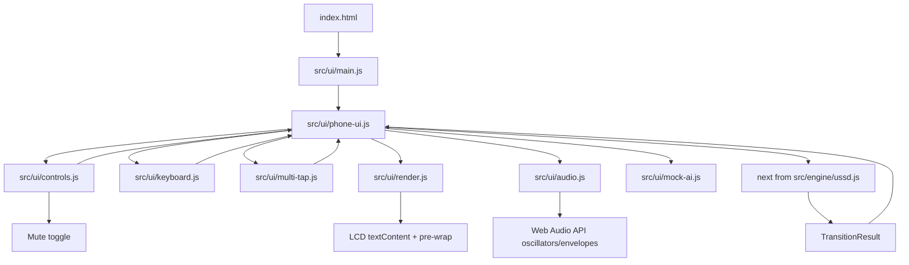
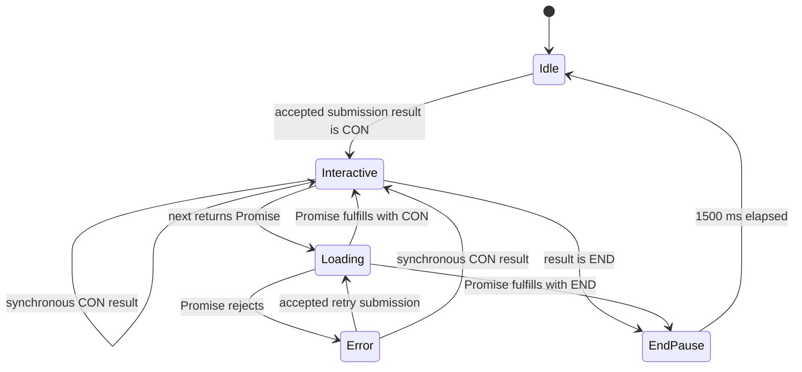

# Design Document

## Overview

The Phone UI is a browser-only adapter around GhostDial's existing USSD state machine. It presents one unbranded retro phone, converts keypad and physical-keyboard events into complete input strings, calls `next(state, input, aiProvider)` exactly once per accepted submission, and renders the returned screen without reimplementing menu, quiz, score, pagination, or AI-response rules. A separate, presentation-only Web Audio service adds short key beeps, a connecting tone during asynchronous loading, and a clear mute toggle without participating in controller state or engine behavior.

The design follows the current project conventions:

- Plain ES modules under `src/`.
- `next` from [`src/engine/ussd.js`](../../../src/engine/ussd.js) remains the only session-transition boundary.
- [`src/engine/menus.js`](../../../src/engine/menus.js) remains the source of screen text and `CON`/`END` results.
- [`src/engine/paginate.js`](../../../src/engine/paginate.js) remains the source of pagination behavior.
- Vitest and fast-check remain the unit and property-testing tools already used by the project.

The UI owns browser concerns only: DOM construction, safe text rendering, event normalization, input buffering, multi-tap timing, loading/error/end pause presentation, audio presentation, mute control, and supplying a local mock AI provider. The audio service is injected into the controller, defaults to a no-op implementation in tests, and receives presentation events without reading or mutating Engine_State, Input_Buffer, lifecycle transitions, timers, or engine arguments. The engine state remains an opaque serializable value to the UI except for the required `engineState?.view?.kind === 'question'` check that selects phone multi-tap behavior.

### Research findings that inform this design

Repository inspection established the following constraints:

1. `next(state, input, aiProvider)` returns a plain result for navigation and quiz transitions, but returns a native Promise for question submissions even when the provider itself returns a string. A provider rejection is converted by the engine into an `ai-error` result.
2. An engine result always has `{ state, screen: { type: 'CON' | 'END', text } }`. Active screens use `CON`; an ended state uses `END`.
3. The engine preserves complete question strings and uses exact `0` and `00` controls. The UI must therefore never trim or reinterpret the submitted buffer.
4. Engine pagination uses JavaScript string `.length` semantics and produces pages no longer than 160 code units. The UI applies the same `.length` limit to its input buffer.
5. Existing tests use Vitest with `fast-check` and distinguish unit, integration, and property tests. The Phone UI follows that split rather than adding a second application framework.
6. Web Audio API calls may be unavailable or blocked until a user gesture. Audio must therefore be lazy, injectable, and best-effort; no audio failure may affect the UI state machine.

## Goals and Non-Goals

### Goals

- Load a single browser entry page with no UI framework.
- Present exactly one phone enclosure, LCD, 12-key keypad, Call control, and Clear control.
- Preserve every accepted input character, including spaces, punctuation, `*`, `#`, and multi-tap output.
- Enforce the 160-character input limit before changing the buffer.
- Support question-specific multi-tap input with an 800 ms commit window, wraparound, and repeated/held-key activations.
- Render engine text as literal LCD text, including special characters and line breaks.
- Keep loading, recoverable error, and 1,500 ms END pause behavior explicit and testable.
- Provide a deterministic local AI provider with a configured 1,200 ms delay and an answer long enough to exercise existing pagination.
- Add presentation-only dial-tone key beeps, a loading connecting tone, and a mute toggle using generated Web Audio only.
- Keep audio injectable and no-op-able so automated tests do not require an AudioContext or real-time audio.

### Non-Goals

- Reimplementing any route, menu, quiz, score, pagination, or screen-copy decision from the engine.
- Calling `api/ask.js`, a network endpoint, browser storage, or an external AI service.
- Adding a UI component framework, router, state-management package, or CSS framework.
- Changing `src/engine/` or `tasks.md`.
- Persisting a Phone UI session after the page is unloaded.
- Shipping audio files, loading audio over the network, or making audio a prerequisite for interaction.

## Architecture



### Runtime flow

1. `index.html` loads the `src/ui/main.js` module. The entry module creates the phone UI and renders the idle state with an empty input buffer. It does not call the engine or create an `AudioContext` during page load.
2. A keypad, Clear, Call, mute-toggle, or keyboard event is normalized into an action. Character, Clear, Call, and keyboard input actions are ignored while loading or during the END pause; the mute toggle remains available because it is presentation-only. Accepted key actions notify the audio service after the controller accepts them; ignored and disabled actions do not notify it.
3. A character action goes through the input controller. The controller checks the current lifecycle state, the 160-code-unit limit, and whether the opaque engine state's view kind is exactly `question`.
4. A submission action commits pending multi-tap state, captures the complete buffer, clears the visible input state, and invokes `next` once with the engine state active at the beginning of submission or `null` while idle. It passes the same `mockAIProvider` function on every call.
5. A synchronous result is adopted immediately. A Promise causes loading to render before settlement and starts the connecting tone. Fulfillment adopts the complete returned state and screen and stops the connecting tone. Rejection leaves the prior engine state active, stops the connecting tone, and enters the recoverable error state with an empty buffer.
6. A result with `screen.type === 'END'` enters the END pause. The connecting tone is already stopped before this state is rendered. A 1,500 ms timer then clears the engine state and input state and returns to idle.
7. Audio is best-effort presentation only. The first accepted user gesture that audio handling receives may lazily create or resume an `AudioContext`; unsupported, blocked, or failed audio operations are caught and ignored without changing controller state or delaying event handling.

### Lifecycle states

The UI lifecycle is separate from the engine's `active`/`ended` status:



`Idle`, `Interactive`, and `Error` are interactive states. `Loading` and `EndPause` reject all input actions. The UI never derives a route from `screen.text`; it uses lifecycle flags for enablement and the one explicitly required `engineState?.view?.kind` check for multi-tap selection. The connecting tone is derived from lifecycle transitions only: start it once when entering `Loading`, keep it active while the Promise is pending, and stop it on fulfillment, rejection, cancellation, or any defensive transition out of `Loading`. Stopping is idempotent and does not alter lifecycle state.

### Browser boundary

`index.html` contains the semantic shell and one module script pointing into `src/ui/`. UI modules import only browser-native APIs and the engine's public `next` function. No `api/ask.js` import is present. The Vite entry can serve the document in development, while the UI code remains ordinary browser JavaScript and can be opened without a framework runtime. Web Audio is accessed only by the injected audio service through the browser's `AudioContext`/`webkitAudioContext` constructor when available; no audio file, `<audio>` element, or network audio request is used.

The UI keeps DOM references in a view object rather than querying by screen text. The engine state and UI state are held in one controller instance, and every render is a targeted update of the LCD output, input line, disabled state, mute-toggle state, and lifecycle attributes. Audio state is held separately and is never serialized into or merged with the engine state.

## Components and Interfaces

### `index.html`

Responsibilities:

- Provide the document title and one root mount point for the generated phone enclosure, including its mute toggle.
- Load `src/ui/main.js` with `type="module"`.
- Avoid brand names, manufacturer names, logos, and framework bootstraps.
- Provide no duplicated engine menu text. Idle and engine copy come from the UI controller or engine result.

The entry document should contain a stable root such as `<main id="app"></main>`. `main.js` constructs the exact phone enclosure beneath that root.

### `src/ui/main.js`

Responsibilities:

- Import `next` from `../engine/ussd.js`.
- Import the mock provider, default Web Audio service, and Phone UI factory.
- Create the UI after the document is ready.
- Render the initial idle state without an engine invocation or audio-context creation.

Suggested entry:

```js
import { next } from '../engine/ussd.js';
import { createMockAIProvider } from './mock-ai.js';
import { createAudioService } from './audio.js';
import { mountPhoneUI } from './phone-ui.js';

const mockAIProvider = createMockAIProvider();
const audio = createAudioService();
mountPhoneUI(document.querySelector('#app'), {
  transition: next,
  aiProvider: mockAIProvider,
  audio,
});
```

The exact exported names can vary during implementation, but the dependency direction must remain this way: `main.js` supplies the real engine function, local provider, and audio service, while the controller does not import any network API or construct an `AudioContext` directly.

### `src/ui/phone-ui.js`

Responsibilities:

- Own the UI state machine and DOM event listeners.
- Maintain the opaque `engineState`, lifecycle state, input buffer, multi-tap metadata, and pending timers.
- Invoke the injected transition function once per submission.
- Schedule and cancel the multi-tap commit timer and END pause timer.
- Render idle, engine, loading, failure, and END-pause states.
- Notify the injected audio service only after an accepted key action, and start/stop its connecting tone at lifecycle boundaries.
- Keep audio notifications outside the state snapshot returned by `getSnapshot()` unless a separate presentation snapshot is explicitly requested for view tests.

Suggested interface:

```js
export function mountPhoneUI(root, {
  transition,
  aiProvider,
  audio = createNoopAudioService(),
  clock = globalThis,
} = {}) {
  // Returns a controller useful to browser tests and cleanup code.
}
```

The injected audio service has presentation methods such as `keyBeep()`, `startConnecting()`, `stopConnecting()`, `setMuted(muted)`, and `destroy()`. The controller calls them defensively and never awaits them. A mute-toggle action changes only the audio service's mute setting and its own accessible presentation state; it does not enter the controller action reducer, change `getSnapshot()` engine/lifecycle/input fields, invoke `transition`, or affect timers.

A controller returned for tests may expose `getSnapshot()`, `dispatch(action)`, and `destroy()`. These are test seams, not additional application APIs. `transition` is called as `transition(engineStateAtStart, submittedInput, aiProvider)`. Audio event calls are intentionally observable through the injected fake service rather than real time or browser audio state.

The controller captures submission state synchronously:

```js
function submit() {
  if (!isInteractive()) return;

  commitPendingMultiTap();
  const stateAtStart = engineState;
  const inputAtStart = inputBuffer;
  inputBuffer = '';
  clearPendingMultiTap();
  renderInput();

  const result = transition(stateAtStart, inputAtStart, aiProvider);
  handleTransitionResult(result, stateAtStart);
}
```

The implementation must ensure that one user action cannot call `submit` twice through both a button event and a bubbled keyboard event. Button handlers use `click`; keyboard handlers process the physical event once and do not synthesize a second click. An accepted key action calls `audio.keyBeep()` once, after the action has passed lifecycle and action-specific acceptance checks. This includes Character_Key, Call_Key, and Clear_Key activations, plus handled unmodified printable, Enter, and Backspace keyboard events. The mute toggle is a presentation control and does not beep. Ignored, disabled, modified, unsupported, or capacity-rejected actions produce no beep.

### `src/ui/controls.js`

Responsibilities:

- Build exactly 12 Character_Key buttons in this order: `1 2 3`, `4 5 6`, `7 8 9`, `* 0 #`.
- Build Call and Clear controls outside the keypad grid.
- Build one mute toggle inside the retro phone enclosure, outside the keypad grid, with a clear accessible name such as `Mute audio` when audio is enabled and `Unmute audio` when muted.
- Normalize each button activation into `{ type: 'character', label }`, `{ type: 'call' }`, `{ type: 'clear' }`, or `{ type: 'mute-toggle' }`.
- Apply disabled behavior through the controller's lifecycle guard rather than allowing controls to mutate state directly.

The mute toggle remains operable while the phone is loading or in the END pause because it is a presentation control, not input to the USSD session. Its visible label or `aria-pressed` state must make the current audio setting clear, and it must use no brand or manufacturer wording.

### `src/ui/audio.js`

`audio.js` owns all Web Audio API work and exposes a small injectable service. It must not import the engine, inspect DOM text, or own controller/lifecycle state. A compatible interface is:

```js
export function createAudioService({
  AudioContextCtor = globalThis.AudioContext ?? globalThis.webkitAudioContext,
  now = () => globalThis.performance?.now?.() ?? Date.now(),
} = {}) {
  return {
    keyBeep(),
    startConnecting(),
    stopConnecting(),
    setMuted(muted),
    isMuted(),
    destroy(),
  };
}

export function createNoopAudioService() {
  // Same methods; no browser audio and no timers.
}
```

The real service lazily constructs an `AudioContext` only from an accepted user gesture received by `keyBeep()` or the mute toggle. If the context is suspended, it attempts `resume()` without awaiting it; rejected promises, missing constructors, oscillator errors, and blocked autoplay are caught and ignored. The service never throws into event handling, never waits for audio before returning, and never makes a network request.

`keyBeep()` creates a short generated dial-tone-style sound with one or two oscillators and a gain envelope, for example a brief pair of sine tones with a fast attack and release. Exact frequencies and duration are presentation constants, not engine semantics. `startConnecting()` creates or updates a low-volume repeating/generated connecting tone while loading; `stopConnecting()` cancels or ramps down that tone and is idempotent. The connecting tone must have no unbounded timer: its repetition is scheduled by the audio graph or a service-local bounded mechanism and is always stopped on `stopConnecting()` and `destroy()`.

The service starts unmuted by default, so audio is enabled unless the user selects mute. `setMuted(true)` immediately prevents new beeps and stops audible connecting output while retaining whether the controller currently wants a connecting tone. `setMuted(false)` enables later sounds and resumes the connecting tone if Loading_State is still active; it does not replay missed key beeps. The controller may call `startConnecting()` again only for a new Loading_State entry. Mute state is presentation state only and is not included in Engine_State, transition snapshots, lifecycle state, input buffers, or timer decisions.

### Audio event contract

- On-screen Character_Key, Call_Key, and Clear_Key activation: call `keyBeep()` exactly once only when the controller accepts the activation. A disabled control or loading/END-pause activation produces no call. A Character_Key rejected because the buffer is full also produces no call.
- Accepted physical keyboard input: call `keyBeep()` exactly once for an interactive unmodified printable key, Enter, or handled Backspace event. Modified printable keys, unsupported named keys, disabled-state events, and ignored full-buffer printable keys produce no call.
- The mute toggle does not produce a key beep; it updates only audio presentation state.
- Loading entry: call `startConnecting()` exactly once when a transition returns a Promise and the controller enters Loading_State.
- Loading exit: call `stopConnecting()` on Promise fulfillment, Promise rejection, END handling, defensive cancellation, `destroy()`, or any other path that leaves Loading_State. Repeated stops are safe.
- Audio method failures are swallowed. They cannot alter whether an input action is accepted, what arguments reach the engine, or which lifecycle transition occurs.

### `src/ui/keyboard.js`

Responsibilities:

- Classify `KeyboardEvent.key` values.
- Accept printable Unicode characters only when no Ctrl, Alt, or Meta modifier is active.
- Recognize exact `Enter` and `Backspace` commands while interactive.
- Leave unsupported named keys and modified printable keys untouched, including browser default behavior.
- Call `preventDefault()` only for accepted unmodified printable input, Enter, and Backspace actions that the UI handles.

A printable classifier accepts exactly one printable Unicode scalar value, including a space, punctuation, digit, letter, `*`, or `#`. It rejects named keys and Unicode control, format, surrogate, private-use, and unassigned characters. The buffer limit uses `inputBuffer.length`, matching the engine's JavaScript code-unit convention. Therefore a valid scalar represented by two UTF-16 code units consumes two positions toward 160.

Keyboard action precedence is:

1. If the lifecycle is not interactive, ignore the event.
2. If the key is printable and Ctrl, Alt, or Meta is active, do nothing and do not cancel default behavior.
3. If the key is exact `Enter`, submit once.
4. If the key is exact `Backspace`, remove one final Unicode scalar from the buffer when it is non-empty; clear pending metadata when the removed character was pending. The 160-character admission check still uses JavaScript string `.length` code units.
5. If the key is an unmodified printable character, commit pending multi-tap and append the exact key when capacity permits.
6. Otherwise, do nothing and preserve browser default behavior.

### `src/ui/multi-tap.js`

Responsibilities:

- Export the fixed mapping:

```js
export const MULTI_TAP_MAPPING = Object.freeze({
  0: ' ',
  2: 'abc',
  3: 'def',
  4: 'ghi',
  5: 'jkl',
  6: 'mno',
  7: 'pqrs',
  8: 'tuv',
  9: 'wxyz',
});
```

- Track `{ digit, index, bufferPosition, activatedAt }` for the pending final character.
- Use `engineState?.view?.kind === 'question'` as the only state-based switch for multi-tap behavior.
- Treat each normalized repeated activation, including one with a browser repeat flag, as one activation.
- Replace the pending final character for the same mapped digit when elapsed time is less than 800 ms, wrapping from the final mapping character to the first.
- Commit pending output before a different character, a printable keyboard character, Clear, or Call.
- Schedule a commit at 800 ms. Event handling also checks elapsed time so a timer race cannot allow a stale pending character to cycle after the threshold.

For a mapped digit in a question view, the first activation appends the mapping's first character if capacity permits. A same-digit activation before 800 ms replaces only the pending final character and does not change buffer length. A mapped digit in any non-question state appends its literal digit. `1`, `*`, and `#` in a question view first commit pending output and then append literally.

### `src/ui/render.js` and `src/ui/styles.css`

`render.js` owns DOM updates and `styles.css` owns presentation. The LCD output update is deliberately narrow:

```js
lcdOutput.textContent = screenText;
```

It never assigns `innerHTML`, parses HTML, creates elements from engine text, or inserts screen text into an attribute. CSS applies `white-space: pre-wrap` to the LCD output so CRLF, LF, and CR sequences appear as one visible line break without changing the source screen text. The input line uses the same literal text sink and mirrors the complete buffer.

The LCD uses a dark green or near-black-green background with a sufficiently light green text color. The chosen colors must calculate to at least 4.5:1 contrast using the WCAG relative-luminance formula. The enclosure, keypad, and controls use neutral unbranded labels and shapes only. The mute toggle has a visible text label or state indicator, uses `aria-pressed`, and does not communicate state through color alone.

### `src/ui/mock-ai.js`

Suggested interface:

```js
export function createMockAIProvider({
  delayMs = 1200,
  setTimeoutFn = globalThis.setTimeout,
} = {}) {
  return function mockAIProvider({ mode, question }) {
    return new Promise((resolve) => {
      setTimeoutFn(() => resolve(buildMockAnswer(mode, question)), delayMs);
    });
  };
}
```

`buildMockAnswer` is a deterministic pure function. Equal `mode` and equal complete `question` strings produce equal answer strings. The answer contains a fixed explanatory body longer than the available single-page interactive capacity, so the existing engine's `paginate` call produces at least two pages for every normal request. The question and mode may be included as literal context, but no randomness, current time, network request, or environment-specific data may affect the answer.

The default delay is exactly 1,200 ms. Tests inject timer functions or fake timers; an elapsed browser observation is allowed to fall between 1,100 and 1,300 ms. The provider never imports or references `api/ask.js`.

### Engine integration contract

The UI calls only the imported `next` function:

```js
const result = transition(
  engineStateAtSubmissionStart, // Engine_State or null
  inputAtSubmissionStart,        // exact string, max 160 code units
  aiProvider,
);
```

The UI does not call `renderScreen`, `paginate`, or engine internals directly. It adopts `result.state` by reference as the complete current Engine_State and uses `result.screen.type` and `result.screen.text` only for presentation and lifecycle handling. It never mutates the returned state.

## Data Models

### Phone UI state

```js
/**
 * @typedef {Object} PhoneState
 * @property {null | object} engineState
 * @property {'idle' | 'interactive' | 'loading' | 'error' | 'end-pause'} lifecycle
 * @property {string} inputBuffer
 * @property {MultiTapState | null} multiTap
 * @property {Screen | null} screen
 * @property {object | null} pendingTransition
 * @property {object} audioService
 * @property {boolean} muted
 */
```

`audioService` and `muted` are presentation-only fields held separately from the engine state. They are not passed to `transition`, are not included in transition snapshots, and do not change the meaning of any lifecycle state. A no-op service is valid for all automated tests.

```js
/**
 * @typedef {Object} MultiTapState
 * @property {'0'|'2'|'3'|'4'|'5'|'6'|'7'|'8'|'9'} digit
 * @property {number} index
 * @property {number} bufferPosition
 * @property {number} activatedAt
 */

/**
 * @typedef {{ type: 'CON' | 'END', text: string }} Screen
 */
```

`bufferPosition` identifies the final character's JavaScript string position. The pending character is already in `inputBuffer` and therefore counts toward the 160-code-unit maximum. `activatedAt` uses the injected clock's millisecond time.

### Transition snapshots

When submission starts, the controller creates a transient snapshot:

```js
{
  stateAtStart: EngineState | null,
  inputAtStart: string,
  provider: MockAIProvider
}
```

This snapshot is not persisted as engine state. It prevents a later timer, keyboard event, or Promise settlement from changing the arguments already supplied to `next`. `pendingTransition` stores the Promise and the preserved pre-transition Engine_State only while a Promise is pending.

### Lifecycle presentation data

```js
const UI_COPY = Object.freeze({
  idle: 'Dial *266# to begin',
  loading: 'Contacting the spirits...',
  error: 'Request failed. Try again.',
});
```

The END screen text always comes from the Engine_Result. The UI never replaces it with local copy. A pending Promise displays `loading` and an empty input line; a rejection displays `error`, preserves the pre-transition engine state, and enables interaction again.

### DOM model

The generated structure has one enclosure and these exact semantic regions:

```text
main#app
└── section.retro-phone
    ├── div.lcd-display
    │   ├── div.screen-output
    │   └── div.input-line
    ├── div.keypad[role=group]
    │   ├── button.character-key × 12
    └── div.phone-actions
        ├── button.call-key (Call)
        ├── button.clear-key (Clear)
        └── button.mute-key (Mute audio / Unmute audio)
```

Call, Clear, and the mute toggle are descendants of the enclosure but not descendants of the keypad grid. The keypad is rendered as four rows of three controls, preserving DOM order and visual order. The mute control uses `aria-pressed="false"` when audio is enabled and `aria-pressed="true"` when muted; its accessible name states the action that will occur.

## Correctness Properties

*A property is a characteristic or behavior that should hold true across all valid executions of a system, essentially a formal statement about what the system should do. Properties bridge the human-readable requirements and executable tests. The properties below target pure controller functions and deterministic seams; DOM shape, contrast, Web Audio availability, and real-time tone quality remain example or integration tests where generated input would add little value. Audio properties use a recording fake or no-op service, never a real `AudioContext` or wall-clock delay.*

### Property 1: Bounded, Exact Input Buffer

For any interactive UI state, any accepted character action, and any input buffer of at most 160 JavaScript code units, the controller either appends the exact action text when the resulting length is at most 160 or leaves the complete buffer unchanged when it would exceed 160; it never trims, reorders, normalizes, or replaces existing characters.

**Validates: Requirements 3.4, 3.8, 3.9, 3.10, 4.1, 4.2, 4.3, 5.1**

### Property 2: Question-State Multi-Tap Sequence

For any mapped question digit, any valid question input buffer with capacity for its output, and any sequence of same-digit activations with elapsed time below 800 milliseconds, the pending character follows that digit's mapping in order and wraps to its first character after the final character; any different character action or activation at 800 milliseconds or later commits the pending character before processing the new action, while the buffer remains within 160 code units.

**Validates: Requirements 3.11, 4.2, 4.3, 4.4, 4.5, 4.6, 4.7, 4.8**

### Property 3: Keyboard Classification and Default Behavior

For any interactive state and any generated keyboard event, an unmodified printable key appends its exact key subject to the input limit, while any printable key with Ctrl, Alt, or Meta, and any unsupported named key, leaves the UI state unchanged and does not cancel browser default behavior; every handled printable, Enter, or Backspace event cancels default behavior exactly once.

**Validates: Requirements 5.1, 5.2, 5.4, 5.5, 5.6, 5.7**

### Property 4: Submission Snapshot and Single Invocation

For any interactive or idle UI state and any complete input buffer of at most 160 code units, one accepted Submission_Action commits pending multi-tap output, invokes the transition function exactly once with the Engine_State active at action start (or `null` in idle), the exact complete buffer captured at that start, and the same Mock_AI_Provider, then clears the input buffer and pending multi-tap state.

**Validates: Requirements 1.5, 4.10, 4.11, 4.12**

### Property 5: Result State Adoption and Safe Text Projection

For any valid Engine_Result whose state and screen text are serializable, handling the result stores the complete returned state without modification and projects the complete screen text as literal LCD text; special characters cannot create DOM elements or executable content, and the displayed input line continues to equal the complete input buffer.

**Validates: Requirements 1.6, 3.4, 3.5, 3.7, 3.8**

### Property 6: Disabled-State Action Invariance

For any Loading_State or Ended_Pause_State and any sequence of keypad, Clear, Call, printable-keyboard, Enter, or Backspace actions, the UI performs zero additional engine invocations and preserves the input buffer and any multi-tap state.

**Validates: Requirements 6.5, 6.6, 6.8, 7.3, 7.4, 7.5**

### Property 7: Recoverable Rejection Preservation

For any serializable Engine_State captured before a pending transition, when that transition rejects, the UI leaves Loading_State, preserves the captured Engine_State exactly, keeps the input buffer empty, displays the fixed failure message, and enables subsequent input and submission actions.

**Validates: Requirements 6.9, 6.10, 6.11, 6.12, 6.13**

### Property 8: Mock Provider Determinism

For any AI mode and any complete question string, two Mock_AI_Provider invocations with equal mode and equal question resolve to exactly equal strings after the same configured delay, and the answer is long enough for the existing engine transition to produce at least two pagination pages.

**Validates: Requirements 8.2, 8.3, 8.4**

### Property 9: Accepted Key Audio Is Gated and Isolated

For any interactive state and any generated sequence of on-screen Character_Key, Call_Key, Clear_Key, and physical keyboard actions, a recording audio service receives exactly one `keyBeep()` for each action that the controller accepts, receives none for disabled, modified, unsupported, or capacity-rejected actions, and produces the same engine calls, input buffers, lifecycle transitions, and timers as a no-op audio service.

**Validates: Requirements 1.5, 4.1, 4.3, 5.1, 5.2, 5.7, 6.5, 7.3**

### Property 10: Loading Tone Follows Promise Lifecycle

For any interactive starting state and any transition outcome that is synchronous, fulfills, rejects, enters an END screen, or is defensively cancelled, the audio service starts the connecting tone exactly once only when a Promise enters Loading_State and stops it on every exit from Loading_State; replacing the audio service with a no-op or a throwing fake leaves engine arguments, controller state, input buffers, lifecycle transitions, and timers unchanged.

**Validates: Requirements 1.5, 6.1, 6.2, 6.7, 6.8, 6.9, 7.1, 7.3, 7.5**

### Property 11: Mute Changes Audio Only

For any controller state and any sequence of mute-toggle actions, toggling mute changes only the audio service's mute setting and accessible mute presentation. It never changes Engine_State, Input_Buffer, Multi_Tap_State, lifecycle, transition invocation count, engine arguments, or controller timers; subsequent accepted key actions still follow the same input and engine rules whether audio is muted or enabled.

**Validates: Requirements 1.5, 4.9, 6.5, 6.6, 7.3, 7.5**

### Reflection on Properties

The initial prework identified separate properties for buffer limits, pending-character reservation, mapped-digit behavior, same-digit cycling, wraparound, different-key commit, and repeated activations. Properties 1 and 2 consolidate those cases because the same reducer invariant governs all accepted character actions and all mapped question-digit sequences. The idle and screen input-line mirroring criteria are included in Properties 1 and 5 rather than repeated as separate display properties. Loading and END-pause controls are combined in Property 6 because both states have the same required no-op and zero-invocation behavior. Provider equality and pagination coverage remain together in Property 8 because deterministic content is what makes the pagination assertion meaningful. Properties 9 and 10 keep key-beep gating and connecting-tone lifecycle separate because input acceptance and asynchronous loading have different event boundaries. Property 11 isolates mute presentation state so it cannot duplicate or weaken the controller invariants.

## Error Handling

| Condition | UI behavior | Test level |
|---|---|---|
| Unsupported named keyboard key | Ignore; preserve state; do not call `preventDefault` | Unit/property |
| Modified printable key | Ignore; preserve pending state; do not call `preventDefault` | Property |
| Character would exceed 160 code units | Ignore only that append; preserve the complete existing buffer | Property/edge case |
| Clear while interactive | Empty buffer and pending metadata; do not call engine | Unit/example |
| Call or Enter while loading or END pause | Ignore and make zero engine calls | Unit/property |
| Synchronous `next` result | Adopt immediately; do not enter loading | Integration/example |
| Promise from `next` | Enter loading before awaiting settlement | Integration/example |
| Promise rejection | Preserve pre-transition engine state, show `Request failed. Try again.`, clear input, and re-enable interaction | Integration/property |
| `screen.type === 'END'` | Show returned text and disable input for 1,500 ms, then reset to idle | Timer integration |
| Invalid programmer configuration | Throw during setup or test execution, such as missing transition, invalid root, or invalid provider delay | Unit |
| Engine screen contains markup-like text | Render with `textContent`; never execute, parse, or interpolate it as markup | Security-focused property/example |
| Web Audio unavailable, suspended, autoplay-blocked, or oscillator creation fails | Fail silently; retain normal UI behavior and controller state | Unit/integration |
| Audio service method rejects or throws | Swallow the failure; do not alter input, engine arguments, lifecycle, or timers | Unit/property |
| Mute toggle activated | Update only audio mute presentation; stop active connecting audio when muted and allow later audio when unmuted | Unit/integration |
| Loading exits by fulfillment, rejection, END handling, cancellation, or destroy | Stop the connecting tone idempotently | Unit/property/integration |

Raw provider rejection details are never rendered. The engine already converts provider errors into a normal `ai-error` result, and the UI's own failure copy is fixed so implementation details cannot leak into the LCD.

## Testing Strategy

The project already uses Vitest and fast-check. Phone UI tests should retain the existing `tests/unit`, `tests/property`, and `tests/integration` layout. Browser-facing tests may use a browser-capable Vitest environment or a minimal real-browser harness, but they must exercise the same `src/ui/` modules loaded by `index.html`; no framework test renderer is needed.

### Unit tests

Unit tests cover deterministic examples and boundaries:

- `multi-tap.test.js`: exact mapping table, first character, final-character wrap, 799/800/801 ms boundaries, different-key commit, and 160-code-unit rejection.
- `keyboard.test.js`: printable classification, spaces and punctuation, Ctrl/Alt/Meta behavior, Enter, Backspace, unsupported named keys, and `preventDefault` call counts.
- `render.test.js`: exact idle/loading/error copy, literal special characters, CRLF/LF/CR display behavior, and input-line mirroring.
- `phone-ui.test.js`: Clear, Call, synchronous result, END pause, timer reset examples, and exact audio event gating with a recording fake for accepted/ignored character, Call, Clear, and keyboard actions.
- `audio.test.js`: default unmuted state, mute/unmute semantics, lazy context creation, oscillator/envelope setup, connecting-tone idempotence, silent handling of missing/suspended/blocked contexts, and no-op service behavior.
- `mock-ai.test.js`: default delay configuration, fixed answer shape, no network imports, and at-least-two-page answer through the existing engine.

### Property-based tests

Each property gets one fast-check property test with at least 100 runs. Test comments use the required traceability format:

```js
// Feature: phone-ui, Property 2: Question-State Multi-Tap Sequence
```

The property tests should generate:

- Buffers from empty through 160 code units, including spaces, punctuation, `*`, `#`, and surrogate-pair Unicode scalars where valid.
- Question and non-question engine view kinds.
- Mapped digits, same-digit repeat counts, different labels, and elapsed times below, at, and above the 800 ms threshold.
- Printable keyboard keys and all Ctrl/Alt/Meta combinations.
- Action sequences while loading and during END pause.
- Serializable engine states and special-character screen text including markup-like strings.
- Equal request pairs for the mock provider.
- Action sequences paired with a recording audio service and a no-op or throwing service, covering accepted and ignored key actions, Promise outcomes, mute toggles, and repeated Loading_State exits.

The controller should expose a deterministic clock/timer seam so properties do not sleep for real time. Audio property tests use a recording fake with synchronous methods; they do not create an `AudioContext`, wait for tones, inspect oscillator timing, or depend on autoplay permissions. A property test must use one property-based test per design property, not a hand-built replacement for fast-check.

### Integration tests

Integration tests verify boundaries that generated pure values cannot establish alone:

1. Load `index.html` without `api/ask.js` and assert the UI starts idle with exactly one phone enclosure and the required controls.
2. Spy on the imported engine transition and verify each accepted submission calls it once with the exact input, start state, and mock provider. Return unusual valid screens to prove the UI does not route from screen text.
3. Use a deferred Promise to assert loading is visible before settlement, controls are disabled, fulfillment adopts the result, and rejection enters the recoverable error state without leaking details.
4. Use fake timers with the real mock provider and `next` to verify the approximately 1,200 ms delay, at least two engine pages, and loading persistence while pending.
5. Return an `END` result and verify the exact text remains visible through 1,499 ms, input remains blocked, and the state resets to idle at 1,500 ms.
6. Inject a recording audio fake and verify accepted on-screen Character_Key, Call, and Clear activations and handled physical keyboard input produce one key beep, ignored/disabled input produces none, loading starts one connecting tone, and fulfillment/rejection/END/destroy each stop it without changing controller results.
7. Run a browser-level safe-render test with `&`, `<`, `>`, quotes, apostrophes, and markup-like strings, asserting literal text and no created descendants or execution.
8. In a real-browser smoke test, verify the mute toggle is inside the enclosure, has a clear accessible label and `aria-pressed` state, defaults to enabled audio, and can be toggled during loading without changing engine state or input behavior.

### Static and smoke checks

- Confirm `index.html` points to `src/ui/main.js` and no UI framework package is imported.
- Confirm the UI module graph has no network/API import and the mock provider can be imported when `api/ask.js` is absent.
- Confirm audio imports only browser Web Audio APIs, contains no audio-file or network-audio references, and the default service is safe when `AudioContext` is unavailable.
- Calculate the LCD contrast ratio from the declared CSS colors and assert at least 4.5:1.
- Count the DOM controls and verify keypad order, row/column layout, Call/Clear/mute placement, mute accessibility state, and absence of brand text or logos.

### Coverage and invariants

Every test result should preserve these invariants:

- `inputBuffer.length <= 160` and the displayed input line contains the same sequence.
- Engine state is either `null` in idle or exactly the last successful result state.
- No accepted submission creates more than one engine invocation.
- Loading and END pause actions create zero engine invocations.
- LCD output is always literal text and never an HTML insertion.
- A pending multi-tap character is the final buffer character and counts toward the input limit.
- A Mock_AI_Provider answer is deterministic for equal requests and does not perform network I/O.
- Audio is never required for interaction; audio method failures and mute changes cannot alter controller state, engine arguments, lifecycle transitions, input buffers, or timers.
- At most one connecting tone is active, and every Loading_State exit reaches an idempotent stopped-audio state.
