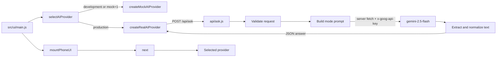

# Design Document

## Overview

The Real AI feature adds one server-only Gemini adapter and one browser provider while preserving GhostDial's existing pure menu engine. `api/ask.js` validates `POST { mode, question }`, reads `process.env.GEMINI_API_KEY`, calls `gemini-2.5-flash`, normalizes the model text, and returns `{ answer }`. `src/ui/real-ai.js` implements the same provider shape as `createMockAIProvider`: a factory returns a function that accepts `{ mode, question }` and fulfills with an answer string. `src/ui/main.js` chooses the real provider only for a production build without the exact `?mock=1` override.

All code remains plain JavaScript ES modules. The implementation adds no browser Gemini dependency and no SDK dependency; the server function uses the runtime's `fetch` operation. Tests inject or mock every request operation and use fake timers, so automated tests make zero real network requests.

### Goals

- Add the Vercel function at `api/ask.js` with the exact project request and response contracts.
- Keep `GEMINI_API_KEY` inside the server function and out of browser assets and project URLs.
- Produce concise, plain-text, spooky but helpful tutoring for `oracle`, `explain-like-5`, and `exam-survival`.
- Add a 15-second browser timeout with abort and timer cleanup.
- Select providers from Vite production state and the exact `mock=1` query parameter.
- Preserve the existing engine, Phone UI, audio service, mock provider, and failure presentation.
- Preserve every existing test file except for the approved replacement of one stale assertion in each of `tests/unit/mock-ai.test.js`, `tests/unit/phone-ui-entry.test.js`, and `tests/integration/phone-ui-boundary.test.js`.

### Non-goals

- Changing any file under `src/engine/`.
- Changing the existing mock provider contract or fallback behavior.
- Streaming responses, chat history, tools, file uploads, model selection, retries, caching, or rate-limit persistence.
- Putting a Gemini key, Gemini endpoint, or Gemini client library in browser code.
- Editing any existing test content other than the three approved stale assertions that require `api/ask.js` to be absent: one in `tests/unit/mock-ai.test.js`, one in `tests/unit/phone-ui-entry.test.js`, and one in `tests/integration/phone-ui-boundary.test.js`.

### Research findings

- Vercel's Node.js runtime serves JavaScript functions placed under the project `/api` directory, which supports the requested `api/ask.js` boundary ([Vercel Node.js runtime](https://vercel.com/docs/functions/runtimes/node-js)).
- The Gemini REST API accepts `POST` requests to a model's `generateContent` action. Authentication can use the `x-goog-api-key` header, and generated text is returned under candidate content parts ([Gemini generateContent reference](https://ai.google.dev/api/rest/v1beta/models/generateContent), [Gemini API overview](https://ai.google.dev/gemini-api/docs)).
- The current repository confirms that `next(state, input, aiProvider)` already injects the provider. The engine sends `oracle` and `eli5`, converts provider rejection to the existing `ai-error` screen, and paginates fulfilled strings. The Exam Survival menu is currently local, so `exam-survival` support exists at the provider and API boundaries without changing engine routes.
- `src/ui/main.js` currently injects `createMockAIProvider()`, so provider selection can remain an entry-point concern.
- The current `tests/unit/mock-ai.test.js`, `tests/unit/phone-ui-entry.test.js`, and `tests/integration/phone-ui-boundary.test.js` assertions that require `api/ask.js` to be absent become stale when the required endpoint is created. The user approved replacing only those three assertions with browser-boundary checks: the `mock-ai.test.js` replacement verifies that `src/ui/main.js` and `src/ui/mock-ai.js` do not import `api/ask.js`; the `phone-ui-entry.test.js` and `phone-ui-boundary.test.js` replacements each verify that browser modules under `src/ui/` do not import `api/ask.js`. These replacements preserve the server/browser boundary and leave every other existing-test line unchanged.

Content based on linked documentation was rephrased for compliance with licensing restrictions.

## Architecture



### Browser request flow

1. `main.js` reads `import.meta.env.PROD` and `globalThis.location.search`.
2. A pure selector chooses the mock provider when production is false or when `URLSearchParams` reports exact value `1` for `mock`; otherwise the selector chooses the real provider.
3. The Phone UI supplies `{ mode, question }` to the selected provider through the unchanged engine.
4. The real provider validates the request locally, maps `eli5` to `explain-like-5`, creates an `AbortController`, and starts an exact 15,000 ms timeout.
5. The provider sends one JSON `POST` to `/api/ask`. It clears the timeout in `finally`, regardless of fulfillment or rejection.
6. A successful response must be JSON with exactly one own field, `answer`, containing a non-empty string. Any HTTP, parse, shape, request, or timeout failure rejects. The provider never falls back to the mock.
7. The unchanged engine catches the rejection and presents its existing recoverable error screen.

### Server request flow

1. The default Vercel handler permits only `POST` and returns `Allow: POST` with status 405 for other methods.
2. A pure validator checks that the body is a non-array object, that `mode` is one of the three API modes, and that `question` is non-empty and at most 160 UTF-16 code units. Additional fields are ignored.
3. The handler checks the injected environment view for a non-empty `GEMINI_API_KEY` before any upstream request.
4. The handler builds separate fixed system instructions and user content. User text is data and cannot select the model, endpoint, headers, output contract, or mode instructions.
5. One server-side `fetch` call targets `https://generativelanguage.googleapis.com/v1beta/models/gemini-2.5-flash:generateContent` with `Content-Type: application/json` and `x-goog-api-key` headers.
6. The request body uses `systemInstruction`, one user `contents` item, and a conservative `generationConfig.maxOutputTokens`; the character limit remains enforced after generation because token limits do not guarantee a UTF-16 length.
7. The handler joins candidate text parts, normalizes them to the Plain_Text contract, truncates safely to 480 UTF-16 code units, and returns `{ answer }`.
8. Validation failures return 400, missing server configuration returns 500, and upstream failures return 502. Public error messages are fixed by category and contain no question, key, upstream body, stack, or internal exception text.

### Security boundaries

- Only `api/ask.js` reads `process.env.GEMINI_API_KEY` or calls the Gemini origin.
- `src/ui/real-ai.js` calls only the same-origin relative path `/api/ask`.
- The Gemini key is sent only in the server-to-server `x-goog-api-key` header. It is absent from query strings, browser requests, returned JSON, and logs.
- The function does not echo submitted questions or upstream payloads in error responses.
- Input validation occurs before model invocation. The fixed model identifier and prompt templates are not derived from request fields.
- Tests inject `fetchImpl` and environment objects. No test relies on a developer key or external network availability.

## Components and Interfaces

### `api/ask.js`

The module exports a default Vercel Node.js handler and named pure helpers for focused testing. A small factory supplies test seams without changing the deployed interface:

```js
export function createAskHandler({
  fetchImpl = globalThis.fetch,
  env = process.env,
} = {}) {
  return async function ask(request, response) {
    // Validate, call Gemini once, normalize, and respond.
  };
}

export default createAskHandler();
```

Responsibilities:

- Restrict the method to `POST` and set JSON content type on every response.
- Accept Vercel's already parsed object body or parse a string/byte body as JSON; reject malformed, array, null, and primitive bodies.
- Validate and copy only `mode` and `question` into the internal request model.
- Read the API key only from the injected server environment view, whose production default is `process.env`.
- Build the Gemini request using the exact `gemini-2.5-flash` path.
- Extract text only from `candidates[].content.parts[].text` string fields.
- Return fixed safe errors and avoid logging secrets or request content.

Suggested named helpers are `validateRequestBody`, `buildSystemInstruction`, `extractCandidateText`, `normalizeAnswer`, and `sendJson`. These helpers keep input transformation testable without invoking HTTP or Gemini.

### Mode prompt policy

A frozen prompt map supplies one fixed instruction per API mode. Every prompt requires plain text, no Markdown, simple English, a maximum of 480 characters, and no preamble about being a model.

- `oracle`: spooky but friendly tutoring that answers the study question directly.
- `explain-like-5`: child-friendly words, one concrete analogy when useful, and a reassuring spooky voice.
- `exam-survival`: practical revision or exam steps in a spooky but encouraging voice.

The user question is placed in a user content part rather than interpolated into the system instruction. The server still normalizes output because model instructions are not an output validator.

### Answer normalization

`normalizeAnswer(candidateText)` is a pure function with these ordered operations:

1. Normalize CRLF and CR to LF.
2. Replace Markdown links with visible label text.
3. Remove code-fence and inline-backtick delimiters.
4. Remove heading, blockquote, and unordered/ordered list markers at line starts.
5. Remove emphasis delimiters and collapse whitespace to single spaces.
6. Trim surrounding whitespace and truncate to at most 480 UTF-16 code units.
7. Return a failure result when no non-whitespace text remains.

The function preserves ordinary letters, numbers, punctuation, and Unicode text. The output contains no control syntax needed by the USSD menu; the existing paginator adds its own `1.More 0.Back` and navigation controls.

### `src/ui/real-ai.js`

```js
export const REAL_AI_TIMEOUT_MS = 15_000;

export function createRealAIProvider({
  fetchImpl = globalThis.fetch,
  AbortControllerCtor = globalThis.AbortController,
  setTimeoutFn = globalThis.setTimeout,
  clearTimeoutFn = globalThis.clearTimeout,
} = {}) {
  return async function realAIProvider({ mode, question }) {
    // Validate, map mode, POST, validate response, and clean up.
  };
}
```

Responsibilities:

- Match the callable provider interface returned by `createMockAIProvider`.
- Validate before starting a timer or request.
- Map provider modes with the frozen table `{ oracle: 'oracle', eli5: 'explain-like-5', 'exam-survival': 'exam-survival' }`.
- Send exactly `Content-Type: application/json`, body `{ mode, question }`, and the abort signal to `/api/ask`.
- Start one exact 15,000 ms timer that aborts the request and causes rejection.
- Validate `response.ok`, JSON parsing, exact response keys, and a non-empty answer string.
- Clear the timer exactly once in `finally` and preserve rejection behavior.
- Contain no Gemini origin, API key access, server module import, or mock fallback.

### `src/ui/main.js`

`main.js` retains its current mount behavior and imports both provider factories. Provider choice is separated into a pure exported helper so tests do not need to mount the DOM:

```js
export function selectAIProvider({ isProduction, search, realProvider, mockProvider }) {
  const forceMock = new URLSearchParams(search).get('mock') === '1';
  return !isProduction || forceMock ? mockProvider : realProvider;
}
```

`mount()` creates both provider functions without invoking either one, selects one, and passes the selected function to the existing `mountPhoneUI` call together with `next` and `createAudioService()`. Selection performs no network operation. Query values such as `mock=true`, `mock=01`, and `mock=0` do not force the mock.

### Existing modules

- `src/engine/**` remains unchanged. Mode translation belongs to `real-ai.js` because the engine already uses `eli5` as part of its stable state contract.
- `src/ui/mock-ai.js` remains unchanged and remains the development provider.
- `src/ui/phone-ui.js` remains unchanged and continues to pass provider rejections through the engine's current failure behavior.
- Existing test files remain unchanged except for the three approved stale-assertion replacements in `tests/unit/mock-ai.test.js`, `tests/unit/phone-ui-entry.test.js`, and `tests/integration/phone-ui-boundary.test.js`. New tests are added beside the existing suites.

## Data Models

### Project API request

```js
/**
 * @typedef {Object} AskRequest
 * @property {'oracle'|'explain-like-5'|'exam-survival'} mode
 * @property {string} question // 1..160 UTF-16 code units
 */
```

Only these two properties cross the browser-to-server trust boundary. Extra incoming properties are discarded before prompt construction.

### Project API success and error responses

```js
/** @typedef {{ answer: string }} AskSuccess */
/** @typedef {{ error: string }} AskError */
```

`AskSuccess.answer` is non-empty Plain_Text with a maximum of 480 UTF-16 code units. `AskError.error` is selected from fixed public strings. Success has exactly one `answer` field; errors have exactly one `error` field.

### Gemini request

```js
{
  systemInstruction: {
    parts: [{ text: modeInstruction }],
  },
  contents: [{
    role: 'user',
    parts: [{ text: question }],
  }],
  generationConfig: {
    maxOutputTokens: 256,
  },
}
```

The exact token ceiling is an implementation guard rather than the user-visible length guarantee. `normalizeAnswer` enforces the 480-code-unit response limit.

### Provider request mapping

| Provider mode | API mode |
|---|---|
| `oracle` | `oracle` |
| `eli5` | `explain-like-5` |
| `exam-survival` | `exam-survival` |

Any other mode, non-string question, empty question, or question longer than 160 code units rejects before `fetch`.

### Provider selection model

| `isProduction` | exact `mock=1` | Selected provider |
|---|---:|---|
| `false` | either | Mock_AI_Provider |
| `true` | `true` | Mock_AI_Provider |
| `true` | `false` | Browser_Provider |

Repeated `mock` parameters use `URLSearchParams.get`, so the first value determines whether the exact override applies. This deterministic rule must be covered by tests.

## Correctness Properties

*A property is a characteristic or behavior that should hold true across all valid executions of a system-essentially, a formal statement about what the system should do. Properties serve as the bridge between human-readable specifications and machine-verifiable correctness guarantees.*

### Property 1: Server Request Validation Is an Exact Allowlist

For all JSON values, server request validation accepts the value if and only if the value is a non-array object whose `mode` is one of `oracle`, `explain-like-5`, or `exam-survival` and whose `question` is a non-empty string of at most 160 UTF-16 code units; every rejected value causes zero Gemini requests.

**Validates: Requirements 1.1, 1.5, 1.6**

### Property 2: Error Responses Are Safe

For all request-validation, configuration, upstream-request, upstream-status, upstream-parsing, and missing-text failure outcomes, the Ask_Function returns JSON containing one fixed public `error` string selected by failure category and copies no API key, submitted question, upstream response body, stack trace, or internal exception message into the response.

**Validates: Requirements 1.7, 2.5, 2.6, 2.7**

### Property 3: Candidate Extraction Accepts Only Text Parts

For all JSON values returned by a mocked Gemini request, candidate extraction either joins the ordered non-empty string values found in `candidates[].content.parts[].text` or reports that no candidate text exists; extraction never coerces non-string values into an answer.

**Validates: Requirements 2.7, 3.2**

### Property 4: Answer Normalization Enforces the Plain-Text Contract

For all candidate strings, successful answer normalization is idempotent and produces trimmed Plain_Text of 1 to 480 UTF-16 code units, while candidate strings with no remaining visible content produce a failure result.

**Validates: Requirements 3.1, 3.2**

### Property 5: Browser Requests Preserve Questions and Map Modes

For all Supported_Provider_Mode values and all Questions, the Browser_Provider makes exactly one `POST` to `/api/ask`, preserves the Question exactly, and maps the provider mode according to `oracle → oracle`, `eli5 → explain-like-5`, and `exam-survival → exam-survival`.

**Validates: Requirements 4.2, 4.3, 4.4**

### Property 6: Successful Provider Responses Preserve Answers

For all Successful_Answer strings returned in an otherwise valid mocked API_Response, the Browser_Provider fulfills with exactly the same string without trimming, normalization, or replacement.

**Validates: Requirements 4.5**

### Property 7: Invalid Provider Inputs Start No Work

For all Provider_Request values whose mode is not a Supported_Provider_Mode or whose question is not a Question, the Browser_Provider rejects and starts zero request operations and zero timeout operations.

**Validates: Requirements 4.9**

### Property 8: Provider Selection Matches the Environment Model

For all production flags and URL query strings, provider selection returns the Mock_AI_Provider exactly when production is false or the first `mock` query value is exactly `1`; provider selection returns the Browser_Provider in every other case.

**Validates: Requirements 5.1, 5.2, 5.3, 5.4, 6.6**

### Property 9: Real Answers Preserve the USSD Screen Limit

For all Successful_Answer strings returned through the Browser_Provider seam to the existing engine, every generated `CON` answer screen, including pagination controls, contains at most 160 UTF-16 code units.

**Validates: Requirements 3.6**

## Error Handling

| Failure | Owner | Result |
|---|---|---|
| Method other than `POST` | Ask_Function | 405, `Allow: POST`, safe JSON error |
| Malformed JSON or non-object body | Ask_Function | 400, safe JSON error |
| Unsupported API mode | Ask_Function | 400, safe JSON error |
| Empty, non-string, or over-160 question | Ask_Function | 400, safe JSON error |
| Missing or empty `GEMINI_API_KEY` | Ask_Function | 500, safe JSON error, zero upstream calls |
| Gemini request rejection or non-success status | Ask_Function | 502, safe JSON error |
| Gemini response is malformed or has no usable text | Ask_Function | 502, safe JSON error |
| Normalization leaves no visible answer | Ask_Function | 502, safe JSON error |
| Invalid Provider_Request | Browser_Provider | Reject before timer or request creation |
| Browser request rejects | Browser_Provider | Clear timer and reject |
| 15,000 ms elapse while pending | Browser_Provider | Abort, clear timer, and reject |
| API status is non-success | Browser_Provider | Clear timer and reject |
| API body is non-JSON or wrong shape | Browser_Provider | Clear timer and reject |
| Provider rejection reaches engine | Existing engine and Phone_UI | Existing `Request failed. Try again.` behavior; no mock fallback |

The handler uses fixed public messages such as `Invalid request.`, `Server configuration error.`, and `AI service unavailable.`. Tests may assert these values, but the browser provider treats all non-success responses alike and does not expose server detail to the engine.

## Testing Strategy

### Test placement

Test changes are limited to the three approved stale-assertion replacements in `tests/unit/mock-ai.test.js`, `tests/unit/phone-ui-entry.test.js`, and `tests/integration/phone-ui-boundary.test.js`, plus these new test files:

- `tests/unit/ask.test.js` for request validation, prompt selection, normalization, response status/shape, and safe errors.
- `tests/unit/real-ai.test.js` for provider validation, request serialization, protocol errors, and timeout cleanup.
- `tests/unit/provider-selection.test.js` for the pure selector and `main.js` wiring seams.
- `tests/integration/real-ai-engine.test.js` for provider rejection and successful-answer flow through the unchanged engine/Phone UI boundaries.
- `tests/property/ask-validation.property.test.js` for Property 1.
- `tests/property/ask-errors.property.test.js` for Property 2.
- `tests/property/ask-extraction.property.test.js` for Property 3.
- `tests/property/answer-normalization.property.test.js` for Property 4.
- `tests/property/real-ai-request.property.test.js` for Property 5.
- `tests/property/real-ai-answer.property.test.js` for Property 6.
- `tests/property/real-ai-invalid.property.test.js` for Property 7.
- `tests/property/provider-selection.property.test.js` for Property 8.
- `tests/property/real-ai-pagination.property.test.js` for Property 9.

The stale `tests/unit/mock-ai.test.js` assertion that requires `api/ask.js` to be absent is replaced with a check that `src/ui/main.js` and `src/ui/mock-ai.js` contain no import of `api/ask.js`. The stale assertions in `tests/unit/phone-ui-entry.test.js` and `tests/integration/phone-ui-boundary.test.js` with the same endpoint-absence requirement are each replaced with a check that browser modules under `src/ui/` contain no import of `api/ask.js`. No other content in those three files or any other Existing_Test_File changes. Every request operation is injected or mocked. A throwing global `fetch` guard proves that tests cannot accidentally use a real network path.

### Unit and edge tests

Vitest example tests cover:

- Exact 200 `{ answer }`, 400, 405 with `Allow`, 500, and 502 contracts.
- Malformed JSON, arrays, null, primitive bodies, boundary question lengths 0, 1, 160, and 161.
- Exact Gemini URL, model, headers, system/user separation, and one upstream call.
- Each fixed mode prompt and the requested tone/content constraints.
- Missing environment key, upstream rejection/status, malformed upstream JSON, and missing text.
- Markdown-like candidate normalization and output truncation.
- Factory shape and zero work during construction.
- Browser protocol failures: non-success status, rejected JSON parse, extra/missing response fields, empty answer, and non-string answer.
- Fake-timer boundaries at 14,999 and 15,000 ms, abort behavior, and `clearTimeout` on both early success and early failure.
- Production/development selection, exact override, near-miss override values, and unchanged mount dependencies.

### Property tests

Use fast-check with at least 100 runs per property. Each design property has one corresponding `fc.assert(fc.property(...), { numRuns: 100 })` test. Each test includes a comment in this exact format:

`Feature: real-ai, Property N: <property title>`

Generated tests exercise only project logic and mocked I/O. They do not repeatedly call Gemini or Vercel. Unit tests remain responsible for concrete boundary examples and timeout edges.

### Integration and static checks

- Pass `createAskHandler` a recording `fetchImpl` and an injected environment object; assert the global request operation remains unused.
- Pass `createRealAIProvider` a mocked `fetchImpl`, fake timers, and a recording AbortController; assert no network access.
- Feed fulfilled and rejected provider calls through the existing `next` function and mounted Phone UI seam without modifying the engine.
- Inspect changed paths to confirm no `src/engine/**` changes, no edits to existing tests other than the three approved stale-assertion replacements in `tests/unit/mock-ai.test.js`, `tests/unit/phone-ui-entry.test.js`, and `tests/integration/phone-ui-boundary.test.js`, and no changes to any other line in those files.
- Inspect browser modules and browser request recordings for `GEMINI_API_KEY`, Gemini origins, secrets, and imports from `api/ask.js`.
- Run targeted new suites with `npx vitest run <new-test-files>` during implementation.

### Approved existing-test exceptions

Implementation may change only three existing-test assertions:

- In `tests/unit/mock-ai.test.js`, replace only the stale assertion that requires `api/ask.js` to be absent. The replacement verifies that neither `src/ui/main.js` nor `src/ui/mock-ai.js` imports `api/ask.js`.
- In `tests/unit/phone-ui-entry.test.js`, replace only the stale assertion that requires `api/ask.js` to be absent. The replacement verifies that browser modules under `src/ui/` do not import `api/ask.js`.
- In `tests/integration/phone-ui-boundary.test.js`, replace only the stale assertion that requires `api/ask.js` to be absent. The replacement verifies that browser modules under `src/ui/` do not import `api/ask.js`.

These replacements directly verify that browser UI code does not cross the server boundary while allowing the required server function to exist. No other line in those three authorized test files and no other Existing_Test_File may change. The complete test suite can pass after `api/ask.js` is added.

## Requirements Traceability

| Requirement | Design coverage |
|---|---|
| 1. Serverless Request Contract | Server request flow, `api/ask.js`, Error Handling, Properties 1-2 |
| 2. Gemini Server Boundary | Security boundaries, `api/ask.js`, Gemini request model, Properties 2-3 |
| 3. Tutor Answer Contract | Mode prompt policy, Answer normalization, Properties 4 and 9 |
| 4. Browser Provider | Browser request flow, `src/ui/real-ai.js`, Provider mapping, Properties 5-7 |
| 5. Provider Selection | `src/ui/main.js`, Provider selection model, Property 8 |
| 6. Compatibility and Automated Verification | Existing modules, Testing Strategy, Approved existing-test exceptions |
