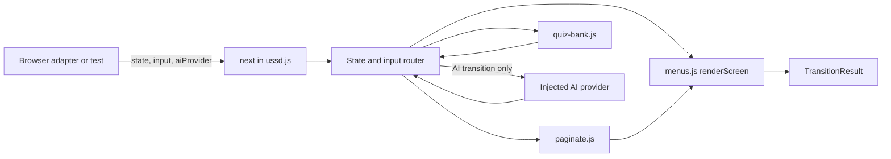
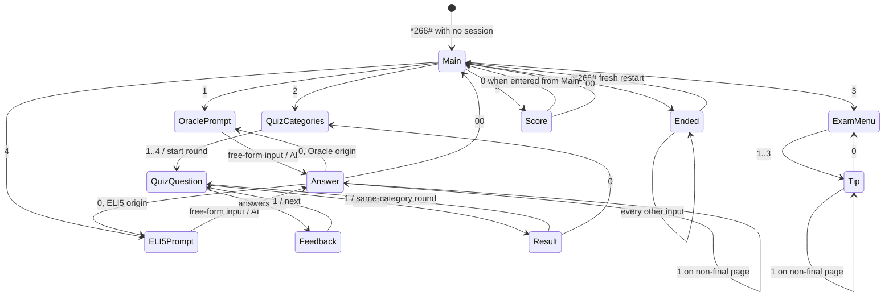

# Design Document

## Overview

The USSD menu engine is a browser-independent state machine for GhostDial. It accepts the current serializable session state, one complete input string, and an injected AI provider. It returns the next state together with a rendered `CON` or `END` screen.

The design keeps navigation, rendering, pagination, quiz data, and quiz rules in plain JavaScript ES modules. It does not include the retro phone UI, browser events, sounds, CSS, network transport, or the implementation of `api/ask.js`.

The public engine boundary is:

```js
next(state, input, aiProvider)
paginate(text, limit = 160)
```

`next` is intentionally not declared `async`. It returns a plain `TransitionResult` for every non-AI transition and returns a native `Promise<TransitionResult>` only when a question is submitted to the AI provider.

## Goals and Non-Goals

### Goals

- Keep all transition behavior deterministic and testable without a browser.
- Preserve the input state and every nested value.
- Model navigation explicitly rather than inferring it from screen text.
- Keep every complete screen at 160 JavaScript string characters or fewer.
- Keep all session data JSON-serializable.
- Isolate the AI call behind an injected provider that tests can replace with a mock.
- Preserve answer and local-tip content exactly while paginating it.
- Prevent a quiz answer from affecting the running score more than once.

### Non-Goals

- Rendering a phone in HTML or CSS.
- Handling keyboard, pointer, audio, animation, or browser storage events.
- Calling Gemini or reading `GEMINI_API_KEY`.
- Implementing the Vercel transport in `api/ask.js`.
- Persisting sessions outside the value returned by `next`.

## Architecture



The engine follows four steps for a non-AI transition:

1. Classify the current lifecycle and view.
2. Interpret the exact input according to that view.
3. create a new immutable state value.
4. Render the new state into a separate screen object.

An AI transition performs the same steps, but inserts one asynchronous provider call between prompt interpretation and creation of the answer view.

## Module Structure

```text
src/
  engine/
    ussd.js          Public next function and state-transition rules
    menus.js         Fixed copy, view rendering, controls, and local tips
    paginate.js      Lossless suffix-aware pagination
    quiz-bank.js     Local categorized questions and answer matching
tests/
  unit/
    ussd.test.js
    menus.test.js
    paginate.test.js
    quiz-bank.test.js
  property/
    transition.property.test.js
    navigation.property.test.js
    paginate.property.test.js
    quiz.property.test.js
    screen.property.test.js
```

### `src/engine/ussd.js`

Responsibilities:

- Export `next(state, input, aiProvider)`.
- Create fresh sessions and absorb input in ended sessions.
- Apply exact `0`, `00`, menu-option, question, page, quiz, and score rules.
- Manage the navigation stack without mutating prior values.
- Build AI requests and call only the injected provider.
- Update quiz acceptance records and the running Haunt Score atomically.
- Call the pure renderer after state transition.

Suggested internal functions:

```js
export function next(state, input, aiProvider) {}

function createFreshState() {}
function transitionActive(state, input, aiProvider) {}
function transitionQuestion(state, input, aiProvider) {}
function transitionQuizAnswer(state, input) {}
function startQuizRound(state, category) {}
function acceptQuizAnswer(state, submittedAnswer) {}
function pushView(state, nextView) {}
function replaceView(state, nextView) {}
function goBack(state) {}
function goHome(state) {}
function invalidChoice(state) {}
function toResult(state) {}
```

### `src/engine/menus.js`

Responsibilities:

- Own all fixed user-facing copy, including exact required messages and option labels.
- Store local Exam Survival content.
- Export an internal pure `renderScreen(state)` function for `ussd.js` and direct tests.
- Append the invalid-choice notice without changing navigation context.
- Return `{ type, text }` and enforce the 160-character invariant.

Suggested exports:

```js
export const INVALID_CHOICE_MESSAGE =
  'Invalid choice. The spirits are confused.';
export const EXIT_MESSAGE = 'The line goes dead... Goodbye.';

export const LOCAL_TIPS = {
  studyPlan: '...',
  examDay: '...',
  beatStress: '...'
};

export function renderScreen(state) {}
```

`renderScreen` is an internal module interface, not an additional application service boundary. Screen text never drives transitions; `state.view.kind` does.

### `src/engine/paginate.js`

Responsibilities:

- Export public `paginate(text, limit = 160)` for AI answers.
- Provide a shared internal paginator that accepts non-final and final suffixes so local tips use the same lossless algorithm.
- Measure limits with JavaScript string `.length`, as required.
- Slice without trimming, normalizing, inserting, or removing content.

Suggested signatures:

```js
export function paginate(text, limit = 160) {}

export function paginateWithControls(
  text,
  limit,
  nonFinalSuffix,
  finalSuffix
) {}
```

### `src/engine/quiz-bank.js`

Responsibilities:

- Store at least five questions for each category: Maths, Physics, Programming, and General.
- Give every question a stable ID and exactly one category.
- Supply exactly five IDs for a round using a deterministic ordering rule.
- Normalize and compare submitted quiz answers locally.
- Constrain every bank entry so its rendered question label/text, all four numbered options, normal navigation text if any, and the full Invalid Choice Message fit together within the 160-character Screen Text limit.

Suggested signatures:

```js
export const QUIZ_CATEGORIES = Object.freeze([
  'maths',
  'physics',
  'programming',
  'general'
]);

export function selectRoundQuestionIds(category, roundNumber) {}
export function getQuestion(questionId) {}
export function getAllQuestions() {}
export function isCorrectAnswer(question, submittedAnswer) {}
```

`getAllQuestions` returns every frozen bank record, or a read-only copy, so development validation and the exhaustive bank test cannot silently omit questions that are not selected in a particular round.

Selection must not use `Math.random()`. A fixed bank order, optionally rotated by `roundNumber`, makes equal state and input produce equal results. Every bank record has exactly four options and must satisfy the complete invalid-notice rendering constraint before it can be added to the bank.

## Components and Interfaces

### Transition Function

```js
/**
 * @param {SessionState | null | undefined} state
 * @param {string} input
 * @param {(request: AIRequest) => Promise<string> | string} aiProvider
 * @returns {TransitionResult | Promise<TransitionResult>}
 */
export function next(state, input, aiProvider) {}
```

Behavioral contract:

- `state == null` accepts only `*266#` as session start. Other inputs produce no active session result only if the caller contract chooses to invoke them; normal callers begin with the Dial Code.
- Every non-AI route returns before any Promise is created.
- A non-control input on a question prompt returns a Promise, even if the supplied provider returns a string synchronously or throws synchronously.
- The function does not mutate, freeze, or attach fields to the caller's input state.
- The function does not inspect browser globals.

The AI branch uses a Promise boundary equivalent to:

```js
return Promise.resolve()
  .then(() => aiProvider(request))
  .then(answer => completeAIAnswer(state, request, answer))
  .catch(() => completeAIFailure(state, request));
```

This construction converts synchronous throws and rejected Promises into a resolved failure transition while preserving the required Promise return type.

### AI Provider

```js
/** @typedef {{ mode: 'oracle' | 'eli5', question: string }} AIRequest */
```

The complete question string is copied unchanged into `request.question`. Exact `0` and exact `00` are handled before request construction. No other input is trimmed or interpreted as a control. The engine calls the provider exactly once for an AI transition and never calls it for quiz, tip, score, menu, lifecycle, or navigation transitions.

A rejected provider call, synchronous provider throw, or non-string provider result creates a local `ai-error` view. Its fixed screen is a `CON` screen with friendly failure text and `0.Back 00.Home`. It does not expose error details, change quiz data, or fabricate answer content. `0` returns to the originating question prompt and `00` returns home. The Promise resolves to this normal `TransitionResult`; it does not reject.

### Pagination Function

```js
/**
 * @param {string} text
 * @param {number} [limit=160]
 * @returns {string[]}
 */
export function paginate(text, limit = 160) {}
```

AI suffixes are exact constants:

```js
const AI_NON_FINAL_SUFFIX = '\n1.More 0.Back';
const AI_FINAL_SUFFIX = '\n0.Back 00.Home';
```

Local-tip suffixes are:

```js
const TIP_NON_FINAL_SUFFIX = '\n1.More 0.Back';
const TIP_FINAL_SUFFIX = '\n0.Back';
```

The public function rejects a non-string `text`, a non-integer limit, or a limit too small to hold the required suffix plus at least one content code unit when non-empty content is supplied. These are programmer errors outside normal state transitions. Empty input still produces one non-empty page consisting of the final suffix, and stripping that suffix reconstructs the empty string.

## Error Handling

The engine distinguishes user input errors, provider failures, and programmer/invariant errors.

| Error class | Handling | Result type |
|---|---|---|
| Unsupported menu or page input | Preserve navigation context and append the exact Invalid Choice Message | Normal synchronous `TransitionResult` |
| AI provider rejects or throws | Render fixed friendly `ai-error` view; keep Back/Home controls; hide raw error details | Resolved `Promise<TransitionResult>` |
| AI provider returns a non-string | Treat as provider failure rather than coercing unknown data | Resolved `Promise<TransitionResult>` |
| Invalid paginator argument | Throw `TypeError` or `RangeError` before building pages | Synchronous programmer error |
| Impossible internal state or overlong rendered screen | Throw an invariant error in development and tests | Synchronous programmer error |

Provider failures never modify quiz progress or score. Invalid user input is ordinary state-machine behavior, not a thrown exception. Public callers are expected to pass a valid state produced by the engine and a JavaScript string input; tests cover argument failures separately from user-facing transitions.

## Data Models

All values below contain only objects, arrays, strings, numbers, booleans, and `null`. Functions, Promises, `Error` instances, DOM nodes, dates, maps, and sets are never stored in session state.

### Session State

```js
/**
 * @typedef {Object} SessionState
 * @property {1} version
 * @property {'active' | 'ended'} status
 * @property {View} view
 * @property {NavigationFrame[]} history
 * @property {QuizState | null} quiz
 * @property {AcceptedAnswer[]} acceptedAnswers
 * @property {number} hauntScore
 * @property {'invalid' | null} notice
 */
```

Example fresh state:

```js
{
  version: 1,
  status: 'active',
  view: { kind: 'main' },
  history: [],
  quiz: null,
  acceptedAnswers: [],
  hauntScore: 0,
  notice: null
}
```

Example ended state:

```js
{
  version: 1,
  status: 'ended',
  view: { kind: 'ended' },
  history: [],
  quiz: null,
  acceptedAnswers: [/* preserved session ledger */],
  hauntScore: 3,
  notice: null
}
```

The ended state keeps its completed session data until exact Dial Code restart replaces the whole value with a fresh state.

### View Union

```js
/** @typedef {
 *  | { kind: 'main' }
 *  | { kind: 'question', mode: 'oracle' | 'eli5' }
 *  | { kind: 'answer', mode: 'oracle' | 'eli5', question: string,
 *      pages: string[], pageIndex: number }
 *  | { kind: 'ai-error', mode: 'oracle' | 'eli5', question: string }
 *  | { kind: 'quiz-categories' }
 *  | { kind: 'quiz-question', questionId: string, questionNumber: number }
 *  | { kind: 'quiz-feedback', acceptanceId: string }
 *  | { kind: 'quiz-result', roundId: number }
 *  | { kind: 'exam-menu' }
 *  | { kind: 'tip', topic: 'studyPlan' | 'examDay' | 'beatStress',
 *      pages: string[], pageIndex: number }
 *  | { kind: 'score' }
 *  | { kind: 'ended' }
 * } View */
```

Answer views retain the originating mode and question, so Back reconstructs the exact question prompt context without relying on screen text. Tip views retain the topic and all ordered pages.

### Navigation Frame

```js
/**
 * @typedef {Object} NavigationFrame
 * @property {View} view
 */
```

A frame stores only the prior renderable view. Session-wide facts such as `acceptedAnswers` and `hauntScore` remain in the current state and are never rolled back by Back navigation. Frames never store `notice`; returning to a screen clears an old invalid-choice message.

Navigation helpers copy arrays and objects:

- `pushView` appends the current view and activates a child view.
- `replaceView` changes the view without adding history.
- `goBack` removes exactly one frame and restores its view.
- `goHome` activates Main Menu and clears history.

Special required Back routes override the generic stack: any answer or AI-error view returns to its originating question prompt, any tip page returns to Exam Survival Menu, and Quiz Result returns to Quiz Category Menu.

### Quiz State and Accepted Answers

```js
/**
 * @typedef {Object} QuizState
 * @property {number} roundId
 * @property {'maths' | 'physics' | 'programming' | 'general'} category
 * @property {[string, string, string, string, string]} questionIds
 * @property {number} questionIndex  // zero-based internally, always 0..4
 * @property {number} roundCorrect
 * @property {string[]} roundAcceptanceIds
 */

/**
 * @typedef {Object} AcceptedAnswer
 * @property {string} id             // `${roundId}:${questionId}`
 * @property {number} roundId
 * @property {string} questionId
 * @property {string} submittedAnswer
 * @property {boolean} correct
 * @property {string} correctAnswer
 */
```

The user-facing question number is `questionIndex + 1`. On first submission for an active question, the engine creates one ledger entry. Before applying an answer, it checks whether that acceptance ID already exists. If it exists, the engine returns to the previously computed feedback or result without changing the ledger, `roundCorrect`, or `hauntScore`.

`roundCorrect` increments only when a new ledger entry is correct. `hauntScore` increments in the same immutable state update. Starting another round clears only round fields and preserves the session ledger and score.

### Transition Result and Screen

```js
/** @typedef {{ state: SessionState, screen: Screen }} TransitionResult */
/** @typedef {{ type: 'CON' | 'END', text: string }} Screen */
```

The renderer is pure:

```js
renderScreen(state) -> { type, text }
```

It derives `type` from `state.status`, not from punctuation or screen copy. Active states always render `CON`; ended states always render exact `END` output. It appends `\nInvalid choice. The spirits are confused.` when `state.notice === 'invalid'`.

Fixed interactive copy and engine-created page sizes reserve enough room for that notice. The engine uses an internal interactive page limit equal to `160 - invalidNoticeWithSeparator.length` when storing AI and tip pages. The public `paginate(text, 160)` contract still accepts the full caller-provided limit. This reserve lets an invalid page input preserve the page content and controls while adding the exact notice without exceeding 160 characters.

## State Machine



Exact `00` Home handling is applied for every active view, including Question Prompt and every Answer Page. Main Menu may simply remain Main Menu. The state-specific routes below run after lifecycle handling and exact Home handling, except where a requirement names a more specific behavior.

## Transition Rules

### Lifecycle Priority

| Current condition | Input | Result | Provider calls |
|---|---|---|---:|
| No session | `*266#` | Fresh active Main Menu | 0 |
| Ended session | `*266#` | Replace with fresh active Main Menu | 0 |
| Ended session | Anything else | Preserve complete state and END screen | 0 |
| Active Main Menu | `0` | Exact exit END screen | 0 |
| Active view outside Main | `00` | Main Menu, clear history | 0 |

Ended-session absorption is evaluated before normal navigation. Therefore `0`, `00`, menu options, and question text cannot reopen or alter an ended session.

### Exact Control Precedence

1. Match complete input strings only; never trim.
2. In a Question Prompt, test exact `0` and exact `00` before treating input as Free Form.
3. On an Answer Page, accept exact `00` from every page, including a non-final page whose displayed suffix lists only More and Back.
4. On Main Menu, exact `0` exits rather than performing a stack pop.
5. Apply view-specific options only after applicable controls.
6. Any remaining input follows that view's invalid-input rule.

Thus `0`, `00`, `10`, `000`, `0 question`, and ` 0` are distinct strings. Only the first two are controls on a Question Prompt.

### Menu Input Validation

Menu screens use `/^[0-9*#]+$/` to recognize Navigation Input. An empty string is not Navigation Input and becomes an invalid choice. A string with any other JavaScript character also becomes invalid. A valid-alphabet string that is neither a displayed option nor an applicable control is likewise invalid.

Invalid handling creates a new state with:

- the same `view`, `history`, `quiz`, accepted-answer ledger, and score;
- `notice: 'invalid'`;
- no provider call.

A later valid transition clears `notice`.

### Main Menu Routes

| Input | Next view |
|---|---|
| `1` | `{ kind: 'question', mode: 'oracle' }` |
| `2` | `{ kind: 'quiz-categories' }` |
| `3` | `{ kind: 'exam-menu' }` |
| `4` | `{ kind: 'question', mode: 'eli5' }` |
| `5` | `{ kind: 'score' }` |
| `0` | Ended session |
| Other | Same context plus invalid notice |

The renderer uses the exact required Main Menu labels and exit message.

### AI Question and Answer Routes

| View | Input | Result |
|---|---|---|
| Question | `0` | Previous screen, zero provider calls |
| Question | `00` | Main Menu, zero provider calls |
| Question | Every other string | One mode-correct provider request |
| Non-final answer | `1` | Increase page index by exactly one |
| Any answer | `0` | Originating Question Prompt |
| Any answer | `00` | Main Menu |
| Final answer | `1` | Same page plus invalid notice |
| Any answer | Unsupported input | Same page plus invalid notice |

### Quiz Routes

Category option mapping is fixed:

| Input | Category |
|---|---|
| `1` | Maths |
| `2` | Physics |
| `3` | Programming |
| `4` | General |

Starting a round chooses exactly five IDs from only that category, sets `questionIndex` to `0`, sets `roundCorrect` to `0`, and assigns a new `roundId`. It preserves `acceptedAnswers` and `hauntScore`.

For questions 1 through 4, the first submitted answer creates an acceptance record and opens feedback. Correct feedback identifies the answer as correct. Incorrect feedback identifies it as incorrect and includes the bank's correct answer. Only exact `1` advances to the next numbered question; exact `0` uses Back; other input is invalid.

The fifth first-submitted answer opens Result directly. Result text contains `The spirits are pleased (X/5)` and ends exactly with `1.Again 0.Back`. Exact `1` starts a fresh round in the same category. Exact `0` opens Quiz Category Menu.

Back from feedback may reveal the already answered question because it is the literal previous screen. That question's acceptance ID remains in the ledger. Submitting from this historical view redisplays its existing feedback and cannot create another acceptance or score increment.

### Score Routes

The Score screen reads `state.hauntScore` and ends exactly with `0.Back 00.Home`.

| Input | Result |
|---|---|
| `0` | Pop one prior view; Main Menu when entered from Main |
| `00` | Main Menu |
| Other | Same score context plus invalid notice |

### Local Exam Survival Routes

Exam Menu option `1`, `2`, or `3` chooses Study plan, Exam-day tips, or Beat stress respectively. The engine reads only `LOCAL_TIPS`; these routes never call `aiProvider`.

Each topic is paginated with the shared suffix-aware helper and the local suffix pair. Exact `1` advances only a non-final page. Exact `0` returns directly to Exam Survival Menu. Exact `00` also returns home under the active-session Home rule, even though local tip suffixes are required to display only More/Back or Back.

## Lossless Suffix-Aware Pagination

`paginateWithControls` performs these steps:

1. Validate `text`, `limit`, and suffix arguments.
2. Compute `nonFinalCapacity = limit - nonFinalSuffix.length` and `finalCapacity = limit - finalSuffix.length` using JavaScript string `.length` values.
3. For empty text, return `[finalSuffix]`.
4. While the remaining text is longer than `finalCapacity`, create a non-final page. Its maximum allowed content prefix is the smaller of `nonFinalCapacity` and `remaining.length - 1`; the latter reserves at least one content code unit for a final page even when the final suffix has less content capacity than the non-final suffix.
5. Within that allowed prefix, find the last space (`' '`) or newline (`'\n'`). When one exists, split immediately after it so the delimiter stays as the final content character on the current page and the next page begins with the following character.
6. When the allowed prefix contains neither a space nor a newline, hard-cut at the allowed capacity. In that case the current unbroken word or run is longer than the effective capacity available while retaining final-page content.
7. Append `nonFinalSuffix` to the selected prefix, remove exactly that prefix from the remaining text, and repeat until the remainder fits with `finalSuffix`.
8. Append the untouched remainder and `finalSuffix` as the final page.

The different non-final and final suffix lengths are considered independently: `finalCapacity` decides whether another page is required, while `nonFinalCapacity` bounds each non-final page. No delimiter is trimmed, duplicated, normalized, or moved to the next page.

A suitable loop is:

```js
while (remaining.length > finalCapacity) {
  const allowed = Math.min(nonFinalCapacity, remaining.length - 1);
  const prefix = remaining.slice(0, allowed);
  const lastBreak = Math.max(
    prefix.lastIndexOf(' '),
    prefix.lastIndexOf('\n')
  );
  const take = lastBreak >= 0 ? lastBreak + 1 : allowed;

  pages.push(remaining.slice(0, take) + nonFinalSuffix);
  remaining = remaining.slice(take);
}
pages.push(remaining + finalSuffix);
```

The implementation uses `slice` on JavaScript strings and keeps JavaScript code-unit `.length` semantics. Preferring delimiters improves readability without changing content: stripping suffixes and concatenating all page content reconstructs the input exactly. A surrogate pair may be split only when a capacity hard-cut is required, but concatenating code units still reconstructs the input exactly and each page obeys the required length measure.

For engine screens that need room for a possible invalid notice, `ussd.js` supplies the smaller internal interactive limit. The algorithm itself always honors the limit supplied by its caller.

## Rendering Rules

`renderScreen` switches exhaustively on `state.view.kind`. Each branch returns fixed or state-derived base text. It then appends the optional invalid notice and checks the final `.length`.

Important renderer rules:

- Main Menu includes all six required options.
- Question prompts identify their mode and show Back/Home controls.
- Answer and tip views return the already suffixed page at `pageIndex`.
- Quiz questions come only from `quiz-bank.js`. Every question rendering includes its question label/text, all four numbered options, and any normal navigation text. The same rendering with `notice: 'invalid'` must also include the full Invalid Choice Message and remain at most 160 characters, so quiz-bank copy is rejected during development or tests if either form exceeds the limit.
- Quiz feedback uses the immutable accepted-answer record, not a newly evaluated input.
- Quiz Result computes display value from `quiz.roundCorrect`.
- Score reads the session-wide `hauntScore`.
- Ended renders only `The line goes dead... Goodbye.` with type `END`.
- All other reachable states render type `CON`.

If internal data would produce a screen over 160 characters, the renderer throws an internal invariant error during development and tests. Fixed copy, quiz-bank entries, and engine pagination limits must make this unreachable in valid production state.

## Immutability and Determinism

Every transition uses object and array copies. No helper mutates `state`, `state.view`, `state.history`, `state.quiz`, `state.acceptedAnswers`, page arrays, or navigation frames. Static constants and quiz-bank records are frozen in development to catch accidental writes.

Deep immutability tests freeze generated input states before calling `next`. Determinism follows from:

- exact string comparisons;
- fixed route tables;
- deterministic quiz selection;
- no clock, random-number, browser, storage, or network access in engine modules;
- provider results supplied as explicit test inputs;
- fixed generic AI failure output that omits environment-specific error text.

## Invariants

Every reachable result must satisfy these invariants:

1. `state` is JSON-serializable and has `version === 1`.
2. The input state remains deeply unchanged.
3. `status === 'active'` if and only if `screen.type === 'CON'`.
4. `status === 'ended'` if and only if `screen.type === 'END'`.
5. `screen.text.length <= 160`.
6. `notice` is `null` or `'invalid'` and never changes navigation context by itself.
7. `hauntScore` is an integer equal to the number of correct records in `acceptedAnswers`.
8. Accepted-answer IDs are unique, so one question in one round contributes at most once.
9. An active quiz has exactly five category-matching question IDs.
10. `quiz.questionIndex` is in `0..4` and user-facing question number is in `1..5`.
11. Every quiz question screen, including the question label/text, all four numbered options, normal navigation text if any, and the complete `Invalid choice. The spirits are confused.` notice, has `screen.text.length <= 160`.
12. `quiz.roundCorrect` equals correct records for the current `roundId` and is between zero and the accepted count for that round.
13. Page index is an integer in the bounds of its non-empty page array.
14. Removing page suffixes and concatenating content reconstructs the source text exactly.
15. A non-AI transition performs zero provider calls.
16. A provider call occurs only after non-control input on a Question Prompt.

## Correctness Properties

*A property is a characteristic or behavior that should hold true across all valid executions of a system, a formal statement about what the system should do. Properties connect the human-readable requirements to automated correctness checks.*

### Property 1: Public Contract, Deep Immutability, and Determinism

For all generated valid Session States and Inputs, `next(state, input, aiProvider)` preserves every nested input value and produces the defined Transition Result shape. Every non-AI transition returns synchronously with zero provider calls, every AI transition returns a Promise and uses only its injected provider answer, and repeated equal transitions with deterministic provider results are structurally equal.

**Validates: Requirements 1.1, 1.2, 1.3, 1.4, 1.5, 1.6, 1.7, 1.8, 1.9, 1.10, 1.11, 1.12**

### Property 2: Exact Session Start and Restart Isolation

For all absent sessions and ended Session States, exact Dial Code `*266#` creates a fresh active Main Menu with Haunt Score zero and no prior quiz progress, while every other Input against an ended session preserves the complete ended state and END screen.

**Validates: Requirements 2.1, 2.3, 2.4, 2.7, 8.1**

### Property 3: Menu Input Alphabet and Invalid-Choice Stability

For all active menu states and JavaScript strings, non-empty strings containing only digits, `*`, and `#` enter option evaluation; strings outside that alphabet and unsupported navigation strings preserve the complete screen/navigation context while adding the exact Invalid Choice Message.

**Validates: Requirements 3.1, 3.2, 3.3, 10.6**

### Property 4: Exact Main Menu Routing

For all fresh or reachable Main Menu states and current scores, exact options `1` through `5` route respectively to Oracle Prompt, Quiz Category Menu, Exam Survival Menu, ELI5 Prompt, and a Score screen containing that score; exact `0` produces the specified END screen.

**Validates: Requirements 2.2, 3.4, 3.5, 3.6, 3.7, 3.8, 3.9, 10.4, 10.7**

### Property 5: Question Prompt Control Precedence

For all Oracle and ELI5 Question Prompt states and all JavaScript strings, exact `0` goes Back and exact `00` goes Home with zero provider calls, while every other string is passed unchanged exactly once in an AI Request carrying the matching mode.

**Validates: Requirements 4.1, 4.2, 4.3, 4.4, 4.5, 4.6**

### Property 6: Lossless Ordered AI Pagination

For all JavaScript strings and valid capable Pagination Limits, `paginate` returns one or more non-empty ordered pages whose complete lengths do not exceed the limit, whose non-final and final suffixes are exact, and whose suffix-stripped concatenation equals the original input code-unit-for-code-unit.

**Validates: Requirements 5.1, 5.2, 5.3, 5.4, 5.5, 5.6, 10.1**

### Property 7: AI Page-Control Semantics

For all generated one-page and multi-page AI answer states, exact `1` advances exactly one position only from a non-final page, exact `0` returns to the originating prompt, exact `00` returns from every page to Main Menu, and every unsupported input preserves page context while adding the Invalid Choice Message.

**Validates: Requirements 5.7, 5.8, 5.9, 5.10, 5.11**

### Property 8: Quiz Category Preservation and Five-Question Bounds

For all Quiz Categories and reachable round states, a round contains exactly five questions from only the selected category, starts at question 1 with round count zero, keeps question and correct-count values within their required bounds, accepts exactly five answers before completion, and preserves category when repeated.

**Validates: Requirements 6.1, 6.2, 6.3, 6.4, 6.5, 6.6, 6.7, 6.8, 6.9, 6.10, 6.11, 6.12, 7.9**

### Property 9: Quiz Feedback Gates Progress

For all questions 1 through 4 and submitted answers, first acceptance opens feedback before another question; feedback accurately reports correctness and includes the correct answer when needed; only exact `1` advances; and all feedback navigation preserves recorded correctness.

**Validates: Requirements 7.1, 7.2, 7.3, 7.4, 7.5, 7.11**

### Property 10: Quiz Completion and Repeat Semantics

For all sequences of five accepted answers, the fifth opens Result rather than Feedback, displays `The spirits are pleased (X/5)` with X equal to the sum of correct answers, ends with exact result controls, repeats in the same category for `1`, and returns to Quiz Category Menu for `0`.

**Validates: Requirements 7.6, 7.7, 7.8, 7.9, 7.10, 7.11**

### Property 11: Integer Session Score and Duplicate Prevention

For all generated quiz-answer and navigation traces in one session, Haunt Score remains an integer equal to the count of unique correct Accepted Answers, increases exactly once for each newly accepted correct answer, stays unchanged for incorrect or already accepted answers and gate navigation, and survives the start of another round.

**Validates: Requirements 7.11, 8.1, 8.2, 8.3, 8.4, 8.5, 8.6, 8.7**

### Property 12: Haunt Score Display and Controls

For all active sessions and accumulated scores, the Score screen contains the current score and exact control ending, exact `0` restores one Previous Screen, exact `00` opens Main Menu, and every other input preserves score context while adding the Invalid Choice Message.

**Validates: Requirements 3.8, 8.8, 8.9, 8.10, 8.11, 8.12, 8.13**

### Property 13: Exact Local Exam Tips Without AI

For all local tip topics and page positions, the selected Exam Survival option uses zero provider calls, maps to the correct local content, produces ordered suffix-correct pages no longer than 160 whose stripped concatenation exactly reconstructs that content, advances one non-final page for `1`, and returns to Exam Survival Menu for `0`.

**Validates: Requirements 9.1, 9.2, 9.3, 9.4, 9.5, 9.6, 9.7, 9.8, 9.9, 9.10, 9.11**

### Property 14: Universal Screen Protocol

For all reachable Session States, Screen Type and Screen Text are separate, complete Screen Text length is at most 160 JavaScript characters, active screens use `CON`, ended screens use `END`, and required Main Menu, invalid-choice, and exit copy remains exact.

**Validates: Requirements 1.7, 10.1, 10.2, 10.3, 10.4, 10.6, 10.7**

The friendly haunted tone in Requirement 10.5 is checked through review and fixed-copy snapshot examples because tone is not a meaningful universally quantified program property.

## Testing Strategy

Vitest runs in a Node environment under Vite. No test imports browser UI modules. fast-check supplies generated valid state, input, text, category, answer, and command-sequence data.

Every property test uses at least 100 generated cases:

```js
fc.assert(
  fc.property(generatedInput, value => {
    // assertion linked to one design property
  }),
  { numRuns: 100 }
);
```

Each property test name includes the required tag:

```text
Feature: ussd-menu-engine, Property 6: Lossless Ordered AI Pagination
```

### Generators

- `navigationInputArb`: non-empty strings from digits, `*`, and `#`.
- `outsideNavigationInputArb`: strings guaranteed to contain at least one other character.
- `freeFormInputArb`: arbitrary JavaScript strings, including empty, whitespace, Unicode, `0` substrings, and `00` substrings.
- `activeStateArb`: valid states for each active view with consistent nested fields.
- `endedStateArb`: arbitrary valid completed-session ledgers and scores.
- `answerViewArb`: valid one-page and multi-page answer views with any page index.
- `quizTraceArb`: category plus answer and navigation command sequences.
- `tipViewArb`: every local topic and valid page index.
- `deterministicProviderArb`: a spy returning generated answer text or a configured rejection.

Generated states are constructed through test builders that enforce the design invariants. Separate negative unit tests cover intentionally malformed arguments.

### Property-to-Test Mapping

| Property | Primary test file | Main oracle |
|---:|---|---|
| 1 | `transition.property.test.js` | Deep-frozen input, return-kind check, spy count, structural equality |
| 2 | `navigation.property.test.js` | Fresh-state model and ended-state equality |
| 3 | `navigation.property.test.js` | Input classifier and unchanged-context projection |
| 4 | `navigation.property.test.js` | Fixed route table |
| 5 | `transition.property.test.js` | Exact-control exclusion and captured AI Request |
| 6 | `paginate.property.test.js` | Suffix stripping round trip and length bounds |
| 7 | `navigation.property.test.js` | Page-index/origin model |
| 8 | `quiz.property.test.js` | Category-filtered five-question reference model |
| 9 | `quiz.property.test.js` | Accepted-answer record and feedback gate model |
| 10 | `quiz.property.test.js` | Five-boolean sum and route model |
| 11 | `quiz.property.test.js` | Unique acceptance-ID reference ledger |
| 12 | `navigation.property.test.js` | Stack-pop/home model and score equality |
| 13 | `paginate.property.test.js` | Local-content round trip and zero-call spy |
| 14 | `screen.property.test.js` | Exhaustive view renderer protocol checks |

### Unit and Example Tests

`tests/unit/quiz-bank.test.js` contains a focused exhaustive bank-length test. It iterates over `getAllQuestions()` rather than a selected round, builds a valid `quiz-question` state for each record with `notice: 'invalid'`, renders it through `renderScreen`, verifies that the question label/text, all four numbered options, any normal navigation text, and the full Invalid Choice Message are present, and asserts `screen.text.length <= 160`. This named exhaustive check is an explicit implementation item for the later task plan, so no bank entry may be replaced by sampling.

Property tests are supplemented by focused examples for:

- exact Dial Code, Main Menu copy, Invalid Choice Message, and Exit Message;
- each fixed Main Menu and Quiz Category mapping;
- empty pagination input and limits at suffix boundaries;
- delimiter-aware pagination at spaces and newlines, delimiter retention on the current page, and hard cuts for runs with no break opportunity within capacity;
- one-page versus multi-page suffixes;
- every quiz-bank question rendered with all four options and the full invalid notice at 160 characters or fewer;
- synchronous provider throw, rejected provider Promise, and non-string provider result;
- correct and incorrect quiz feedback copy;
- all result scores from `0/5` through `5/5`;
- Back from an already accepted historical quiz question;
- score Back from Main Menu and Home from another entry frame;
- representative fixed-copy tone snapshots;
- JSON stringify/parse round trips for fresh, answer, quiz, score, and ended states.

Integration tests are limited to module boundaries. Live AI calls, Vercel deployment behavior, browser rendering, and external services are outside this engine design.

## Requirements Traceability

| Requirement | Design coverage | Verification |
|---|---|---|
| 1. Engine boundary | Public interfaces, module structure, immutability and determinism | Properties 1 and 14; API smoke tests |
| 2. Session lifecycle | Lifecycle priority, state machine, navigation stack | Properties 2 and 4 |
| 3. Menu input and routes | Menu validation and Main Menu route table | Properties 3, 4, and 12 |
| 4. Question controls | Exact control precedence and AI Request contract | Property 5 |
| 5. AI pagination | Suffix-aware algorithm and answer route table | Properties 6 and 7 |
| 6. Quiz construction | Quiz data model, deterministic category selection | Property 8 |
| 7. Quiz feedback/results | Quiz routes and immutable acceptance records | Properties 9 and 10 |
| 8. Haunt Score | Session ledger, duplicate guard, Score routes | Properties 11 and 12 |
| 9. Exam Survival | Local content module and shared tip pagination | Property 13 |
| 10. Screen protocol | Pure renderer, copy constants, length reserve | Properties 3, 4, 6, and 14 |
