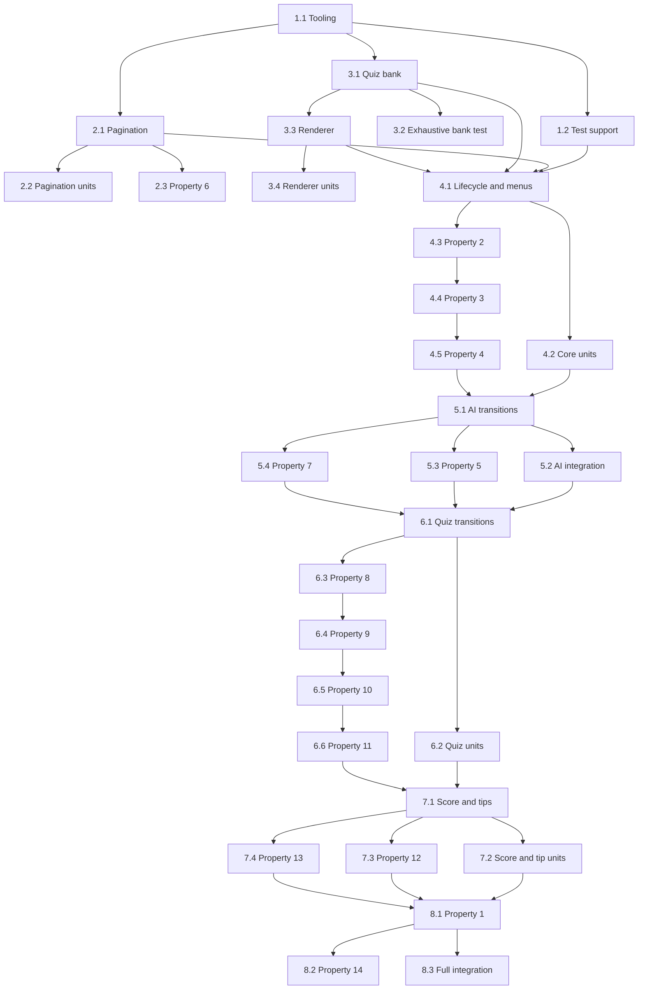

# Implementation Plan: USSD Menu Engine

## Overview

Implement the browser-independent GhostDial USSD engine as plain JavaScript ES modules. Build the work incrementally from project tooling and pure data modules through rendering and state transitions, then verify every required behavior with Vitest unit/integration tests and fast-check properties. All tasks in this plan are required.

## Tasks

- [x] 1. Set up the JavaScript project and reusable test support
  - [x] 1.1 Configure Vite, Vitest, and fast-check
    - Create `package.json` scripts for a one-shot Vitest run and configure Vitest for a Node environment under Vite.
    - Add the required source and test directory structure without adding browser or framework dependencies.
    - Keep the engine package in plain JavaScript ES modules.
    - _Requirements: 1.1, 1.3, 1.12_

  - [x] 1.2 Create shared state builders and mock AI providers for tests
    - Add test helpers that construct valid fresh, active-view, answer, quiz, score, and ended session states without sharing mutable nested values.
    - Add spy providers for successful strings, synchronous throws, rejected promises, and non-string results.
    - Include a passed-in deterministic mock AI provider that returns configurable long fake answers for pagination and transition integration tests.
    - _Requirements: 1.5, 1.8, 1.9, 1.10, 1.11, 4.4, 5.2_

- [x] 2. Implement suffix-aware lossless pagination
  - [x] 2.1 Create `src/engine/paginate.js`
    - Export `paginate(text, limit = 160)` and a shared `paginateWithControls` helper for AI answers and local tips.
    - Validate programmer arguments, account independently for final and non-final suffix lengths, and return a final-suffix page for empty text.
    - Prefer the last space or newline within the allowed prefix, keep that delimiter at the end of the current page, and hard-cut only when no usable delimiter exists.
    - Preserve every JavaScript string code unit so stripping suffixes and concatenating page content reconstructs the source exactly.
    - _Requirements: 5.1, 5.2, 5.3, 5.4, 5.5, 5.6, 9.5, 9.6, 9.7, 9.8, 9.9, 10.1_

  - [x] 2.2 Write focused pagination unit tests
    - Test default and custom limits, empty input, one-page and multi-page suffixes, suffix-boundary limits, and invalid argument errors.
    - Test spaces and newlines near page boundaries, asserting that the selected delimiter remains at the end of the current page.
    - Test long unbroken runs to prove that hard cuts occur only when no space or newline is available in the allowed prefix.
    - Test lossless reconstruction and complete page-length limits for both AI and local-tip suffix pairs.
    - _Requirements: 5.1, 5.2, 5.3, 5.4, 5.5, 5.6, 9.5, 9.6, 9.7, 9.8, 9.9, 10.1_

  - [x] 2.3 Write the fast-check test for Property 6: Lossless Ordered AI Pagination
    - Generate arbitrary JavaScript strings and capable integer limits, including whitespace, newlines, Unicode code units, and unbroken runs.
    - Assert non-empty ordered pages, exact suffix placement, supplied length bounds, and code-unit-for-code-unit reconstruction for at least 100 runs.
    - Name the test `Feature: ussd-menu-engine, Property 6: Lossless Ordered AI Pagination`.
    - _Requirements: 5.1, 5.2, 5.3, 5.4, 5.5, 5.6, 10.1_

- [x] 3. Implement local content, quiz data, and screen rendering
  - [x] 3.1 Create `src/engine/quiz-bank.js`
    - Define frozen Maths, Physics, Programming, and General question records with stable IDs, exactly four options, local correct answers, and at least five questions per category.
    - Export deterministic category-only five-question round selection without clocks or randomness, complete bank enumeration, lookup, and local answer comparison.
    - Keep every record compact enough for its full numbered question screen and complete invalid-choice notice to fit in 160 characters.
    - _Requirements: 6.2, 6.3, 6.4, 6.5, 6.8, 6.9, 6.12, 7.2, 7.3, 10.1_

  - [x] 3.2 Write quiz-bank unit tests, including exhaustive screen-length coverage
    - Verify all four category mappings, stable deterministic selection, exactly five category-matching IDs, four options per question, and correct-answer comparison.
    - Iterate every record returned by `getAllQuestions()`, render a valid quiz-question state with `notice: 'invalid'`, and assert that the full question, all four numbered options, and the complete `Invalid choice. The spirits are confused.` notice are present and total no more than 160 characters.
    - Do not sample or limit the exhaustive bank iteration.
    - _Requirements: 3.2, 6.2, 6.3, 6.4, 6.5, 6.8, 6.9, 10.1, 10.6_

  - [x] 3.3 Create `src/engine/menus.js`
    - Define the exact invalid-choice and exit messages, all fixed haunted but plain-English menu copy, and local Study plan, Exam-day tips, and Beat stress content.
    - Implement pure exhaustive `renderScreen(state)` output with separate `type` and `text`, exact required control endings, score/result interpolation, and page rendering.
    - Append an invalid notice without changing navigation context and enforce the 160-character screen invariant.
    - Render Main Menu, both question prompts, AI answer/error, quiz category/question/feedback/result, Exam Survival/tip, score, and ended views.
    - _Requirements: 1.6, 1.7, 3.4, 3.5, 3.6, 3.7, 3.8, 5.4, 5.5, 7.2, 7.3, 7.7, 7.8, 8.8, 8.9, 9.2, 9.3, 9.4, 9.7, 9.8, 10.1, 10.2, 10.3, 10.4, 10.5, 10.6, 10.7_

  - [x] 3.4 Write renderer and fixed-copy unit tests
    - Verify exact Main Menu options, Invalid Choice Message, Exit Message, required suffix/control endings, `CON`/`END` types, and representative friendly haunted wording.
    - Cover every view variant, result scores from 0/5 through 5/5, invalid-notice rendering, and overlength invariant failures.
    - Verify local content is available without an AI provider and fixed interactive screens stay within 160 characters.
    - _Requirements: 1.6, 1.7, 7.2, 7.3, 7.7, 7.8, 8.8, 8.9, 9.1, 9.2, 9.3, 9.4, 10.1, 10.2, 10.3, 10.4, 10.5, 10.6, 10.7_

- [x] 4. Implement session lifecycle, navigation helpers, and main-menu routing
  - [x] 4.1 Create the synchronous core of `src/engine/ussd.js`
    - Export `next(state, input, aiProvider)` and create JSON-serializable fresh/ended states with immutable view, history, quiz, accepted-answer, score, and notice fields.
    - Implement lifecycle priority for exact Dial Code start/restart, ended-session absorption, Main Menu exit, and fresh-session score/quiz isolation.
    - Implement immutable push, replace, Back, Home, invalid-choice, and rendering helpers without inspecting screen text or browser globals.
    - Implement menu input-alphabet checks and exact Main Menu routing to Oracle, quiz categories, Exam Survival, ELI5, and score views.
    - Ensure every completed non-AI route returns synchronously and makes zero provider calls.
    - _Requirements: 1.2, 1.3, 1.4, 1.6, 1.8, 1.9, 1.11, 2.1, 2.2, 2.3, 2.4, 2.5, 2.6, 2.7, 3.1, 3.2, 3.3, 3.4, 3.5, 3.6, 3.7, 3.8, 3.9, 8.1, 10.7_

  - [x] 4.2 Write lifecycle, immutability, menu-routing, and navigation unit tests
    - Cover absent and ended sessions, exact restart isolation, ended-state preservation, Main Menu exit, Back stack behavior, Home clearing, and all exact Main Menu routes.
    - Deep-freeze nested input states and verify transitions never mutate them.
    - Assert unsupported navigation values and strings outside the navigation alphabet preserve context, append the exact notice, and never call the provider.
    - _Requirements: 1.4, 1.6, 1.8, 1.11, 2.1, 2.2, 2.3, 2.4, 2.5, 2.6, 2.7, 3.1, 3.2, 3.3, 3.4, 3.5, 3.6, 3.7, 3.8, 3.9_

  - [x] 4.3 Write the fast-check test for Property 2: Exact Session Start and Restart Isolation
    - Generate absent/ended sessions and arbitrary inputs; assert only exact `*266#` creates a fresh Main Menu with score zero and no prior quiz progress.
    - Assert all other ended-session inputs preserve the complete state and END screen for at least 100 runs.
    - _Requirements: 2.1, 2.3, 2.4, 2.7, 8.1_

  - [x] 4.4 Write the fast-check test for Property 3: Menu Input Alphabet and Invalid-Choice Stability
    - Generate active menu states, valid-alphabet navigation strings, and strings containing outside characters.
    - Assert option evaluation or exact invalid handling with unchanged navigation context and zero provider calls for at least 100 runs.
    - _Requirements: 3.1, 3.2, 3.3, 10.6_

  - [x] 4.5 Write the fast-check test for Property 4: Exact Main Menu Routing
    - Generate reachable Main Menu states and scores, then compare options `1` through `5` and `0` against the fixed route table and exact exit contract for at least 100 runs.
    - _Requirements: 2.2, 3.4, 3.5, 3.6, 3.7, 3.8, 3.9, 10.4, 10.7_

- [x] 5. Implement question prompts and AI answer transitions
  - [x] 5.1 Extend `src/engine/ussd.js` with exact question and answer behavior
    - Give exact `0` and `00` precedence at both question prompts, and pass every other complete string unchanged in one mode-correct AI request.
    - Return a native Promise only for AI transitions, even for synchronous providers, and resolve successful answers into internally paginated answer views with invalid-notice capacity reserved.
    - Convert provider throws, rejections, and non-string results into a friendly local AI-error result without exposing details or changing quiz/score data.
    - Implement More, Back to the originating prompt, Home from every answer page, and invalid final-page/unsupported input behavior.
    - _Requirements: 1.5, 1.9, 1.10, 4.1, 4.2, 4.3, 4.4, 4.5, 4.6, 5.7, 5.8, 5.9, 5.10, 5.11, 10.1_

  - [x] 5.2 Write AI transition unit and integration tests with passed-in mocks
    - Verify exact control precedence versus near-control free-form strings, complete unchanged questions, mode values, one provider call, and Promise return type.
    - Pass the configurable long-answer mock provider into `next`, then test ordered multi-page content, More, Back, Home from non-final and final pages, and final-page invalid handling.
    - Cover synchronous throw, rejected Promise, and non-string provider results, asserting resolved friendly error screens and no leaked error details.
    - _Requirements: 1.5, 1.9, 1.10, 4.1, 4.2, 4.3, 4.4, 4.5, 4.6, 5.7, 5.8, 5.9, 5.10, 5.11_

  - [x] 5.3 Write the fast-check test for Property 5: Question Prompt Control Precedence
    - Generate both prompt modes and arbitrary JavaScript strings, including empty input and strings containing non-exact `0`/`00` substrings.
    - Assert exact controls make zero calls and every other input reaches one mode-correct provider request unchanged for at least 100 runs.
    - _Requirements: 4.1, 4.2, 4.3, 4.4, 4.5, 4.6_

  - [x] 5.4 Write the fast-check test for Property 7: AI Page-Control Semantics
    - Generate valid one-page and multi-page answer states at every page index and both originating modes.
    - Assert More advances only a non-final page, Back restores the originating prompt, Home always opens Main Menu, and unsupported input preserves page context with the notice for at least 100 runs.
    - _Requirements: 5.7, 5.8, 5.9, 5.10, 5.11_

- [x] 6. Implement quiz rounds, feedback gates, results, and scoring ledger
  - [x] 6.1 Extend `src/engine/ussd.js` with deterministic quiz transitions
    - Map category options to Maths, Physics, Programming, and General and start exactly five-question rounds at question 1 with round-correct count zero.
    - Accept each active question once into an immutable unique-ID ledger, update round count and Haunt Score atomically only for a newly accepted correct answer, and block duplicate increments.
    - Show feedback after questions 1 through 4, gate progress on exact `1`, and preserve recorded correctness through feedback/result navigation.
    - Show the result directly after question 5, implement same-category Again and Back to categories, and preserve session score across rounds.
    - Handle Back from historical accepted questions by redisplaying the existing feedback/result without accepting or scoring again.
    - _Requirements: 6.1, 6.2, 6.3, 6.4, 6.5, 6.6, 6.7, 6.8, 6.9, 6.10, 6.11, 6.12, 7.1, 7.2, 7.3, 7.4, 7.5, 7.6, 7.7, 7.8, 7.9, 7.10, 7.11, 8.2, 8.3, 8.4, 8.5, 8.6, 8.7_

  - [x] 6.2 Write quiz transition and score-ledger unit tests
    - Cover every category, five-question bounds, correct/incorrect feedback, feedback gating, all result scores from 0/5 through 5/5, same-category repeat, and Back to categories.
    - Assert each accepted answer is recorded once, duplicate/historical submissions cannot change correctness or score, and new rounds preserve the running score.
    - Verify all quiz routes are synchronous, local, immutable, and make zero provider calls.
    - _Requirements: 1.4, 1.8, 1.11, 6.1, 6.2, 6.3, 6.4, 6.5, 6.6, 6.7, 6.8, 6.9, 6.10, 6.11, 6.12, 7.1, 7.2, 7.3, 7.4, 7.5, 7.6, 7.7, 7.8, 7.9, 7.10, 7.11, 8.2, 8.3, 8.4, 8.5, 8.6, 8.7_

  - [x] 6.3 Write the fast-check test for Property 8: Quiz Category Preservation and Five-Question Bounds
    - Generate categories, round numbers, and reachable quiz states; assert category-only question IDs, exact round size, index/count bounds, fresh-round values, and same-category repeat for at least 100 runs.
    - _Requirements: 6.1, 6.2, 6.3, 6.4, 6.5, 6.6, 6.7, 6.8, 6.9, 6.10, 6.11, 6.12, 7.9_

  - [x] 6.4 Write the fast-check test for Property 9: Quiz Feedback Gates Progress
    - Generate questions 1 through 4 with correct, incorrect, and invalid follow-up inputs.
    - Assert accurate immutable feedback, included correct answers when needed, and exact `1` as the only progress gate for at least 100 runs.
    - _Requirements: 7.1, 7.2, 7.3, 7.4, 7.5, 7.11_

  - [x] 6.5 Write the fast-check test for Property 10: Quiz Completion and Repeat Semantics
    - Generate five-answer correctness sequences and assert direct fifth-answer results, exact X/5 totals/control ending, same-category repeat, and Back to categories for at least 100 runs.
    - _Requirements: 7.6, 7.7, 7.8, 7.9, 7.10, 7.11_

  - [x] 6.6 Write the fast-check test for Property 11: Integer Session Score and Duplicate Prevention
    - Generate quiz-answer and navigation command traces across repeated rounds.
    - Compare Haunt Score to a unique accepted-answer reference ledger and assert exact-once increments, incorrect-answer stability, duplicate prevention, integer bounds, and cross-round preservation for at least 100 runs.
    - _Requirements: 7.11, 8.1, 8.2, 8.3, 8.4, 8.5, 8.6, 8.7_

- [x] 7. Implement Haunt Score and Exam Survival navigation
  - [x] 7.1 Complete score and local-tip transitions in `src/engine/ussd.js`
    - Display the current running Haunt Score with exact controls, pop one Previous Screen for Back, open Main Menu for Home, and preserve score context on invalid input.
    - Route Exam Survival options to the three local topics and paginate them through the shared helper using local-tip suffixes and the internal invalid-notice reserve.
    - Implement one-page advancement for exact `1`, direct Back to Exam Survival Menu, active-session Home, invalid page choices, and zero provider calls on every score/tip transition.
    - _Requirements: 2.5, 2.6, 8.8, 8.9, 8.10, 8.11, 8.12, 8.13, 9.1, 9.2, 9.3, 9.4, 9.5, 9.6, 9.7, 9.8, 9.9, 9.10, 9.11_

  - [x] 7.2 Write Haunt Score and Exam Survival unit/integration tests
    - Test score display after mixed answers and repeated rounds, Back from Main Menu entry, Home, invalid input, and exact control ending.
    - Test all local-topic mappings, one-page and multi-page controls, lossless ordered content, Back/Home, invalid input, and complete 160-character limits.
    - Use provider spies to assert zero calls throughout menu, score, tip, and tip-pagination flows.
    - _Requirements: 1.11, 8.8, 8.9, 8.10, 8.11, 8.12, 8.13, 9.1, 9.2, 9.3, 9.4, 9.5, 9.6, 9.7, 9.8, 9.9, 9.10, 9.11, 10.1_

  - [x] 7.3 Write the fast-check test for Property 12: Haunt Score Display and Controls
    - Generate active sessions with valid accepted-answer ledgers and history frames.
    - Assert displayed score equality, exact suffix, one-level Back, Home, and invalid-context preservation for at least 100 runs.
    - _Requirements: 3.8, 8.8, 8.9, 8.10, 8.11, 8.12, 8.13_

  - [x] 7.4 Write the fast-check test for Property 13: Exact Local Exam Tips Without AI
    - Generate all topics and valid page positions; assert exact topic mapping, zero provider calls, ordered lossless content, exact suffixes, length bounds, one-page advancement, and direct Back for at least 100 runs.
    - _Requirements: 9.1, 9.2, 9.3, 9.4, 9.5, 9.6, 9.7, 9.8, 9.9, 9.10, 9.11, 10.1_

- [x] 8. Verify the complete public contract and reachable-state protocol
  - [x] 8.1 Write the fast-check test for Property 1: Public Contract, Deep Immutability, and Determinism
    - Generate valid states for every view and applicable input, deep-freeze each input state, and compare repeated transitions with deterministic provider results.
    - Assert result shape, synchronous versus Promise return kind, zero provider calls on all non-AI routes, exactly one injected-provider call on AI routes, and no browser dependency for at least 100 runs.
    - _Requirements: 1.1, 1.2, 1.3, 1.4, 1.5, 1.6, 1.7, 1.8, 1.9, 1.10, 1.11, 1.12_

  - [x] 8.2 Write the fast-check test for Property 14: Universal Screen Protocol
    - Generate or walk reachable states across every view and assert JSON-serializable versioned state, separate type/text, active-to-`CON` and ended-to-`END` correspondence, and complete text length at most 160.
    - Assert required Main Menu, invalid-choice, and exit copy remains exact for at least 100 runs.
    - _Requirements: 1.7, 10.1, 10.2, 10.3, 10.4, 10.6, 10.7_

  - [x] 8.3 Add complete engine integration and serialization tests
    - Exercise full deterministic traces for start, Oracle long-answer paging, ELI5, all quiz categories, five-answer feedback/results, score viewing, repeated rounds, all local tips, Home/Back, exit, ended absorption, and restart.
    - Use only passed-in mock providers and assert every non-AI step remains synchronous and local.
    - JSON stringify/parse representative fresh, answer, quiz, score, and ended states, then continue transitions from the parsed values.
    - _Requirements: 1.3, 1.4, 1.5, 1.8, 1.9, 1.10, 1.11, 2.1, 2.3, 2.4, 2.7, 4.4, 5.7, 6.9, 7.6, 7.9, 8.5, 9.1, 10.1_

- [x] 9. Final checkpoint
  - Ensure all tests pass, ask the user if questions arise.

## Notes

- Every task is required. No requested behavior or correctness test is marked optional.
- Each fast-check property uses at least 100 generated cases and has one dedicated task.
- Test commands must use a one-shot run rather than watch mode.
- Implementation tasks build only the engine and automated tests; browser UI, live Gemini calls, `api/ask.js`, deployment, and documentation are outside this feature.
- Checkpoints do not appear in the scheduling graph because they do not write code.

## Task Dependency Graph

```json
{
  "waves": [
    { "id": 0, "tasks": ["1.1"] },
    { "id": 1, "tasks": ["1.2", "2.1", "3.1"] },
    { "id": 2, "tasks": ["2.2", "2.3", "3.2", "3.3"] },
    { "id": 3, "tasks": ["3.4"] },
    { "id": 4, "tasks": ["4.1"] },
    { "id": 5, "tasks": ["4.2", "4.3"] },
    { "id": 6, "tasks": ["4.4"] },
    { "id": 7, "tasks": ["4.5"] },
    { "id": 8, "tasks": ["5.1"] },
    { "id": 9, "tasks": ["5.2", "5.3", "5.4"] },
    { "id": 10, "tasks": ["6.1"] },
    { "id": 11, "tasks": ["6.2", "6.3"] },
    { "id": 12, "tasks": ["6.4"] },
    { "id": 13, "tasks": ["6.5"] },
    { "id": 14, "tasks": ["6.6"] },
    { "id": 15, "tasks": ["7.1"] },
    { "id": 16, "tasks": ["7.2", "7.3", "7.4"] },
    { "id": 17, "tasks": ["8.1", "8.2", "8.3"] }
  ]
}
```


